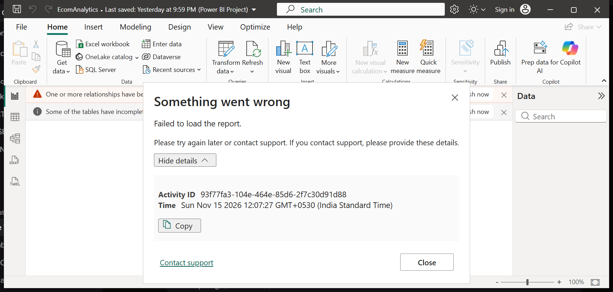
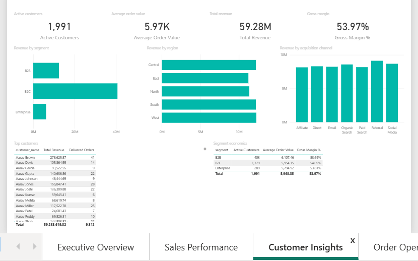
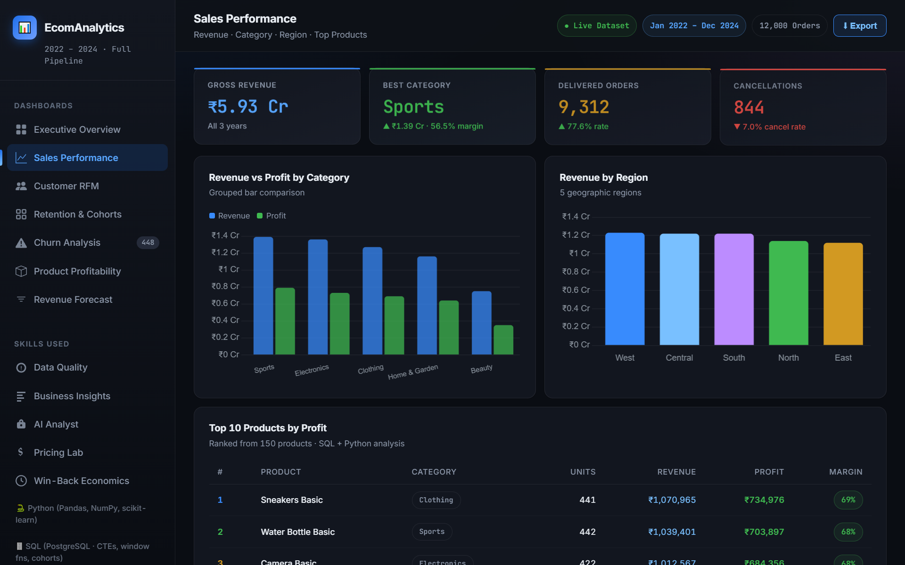
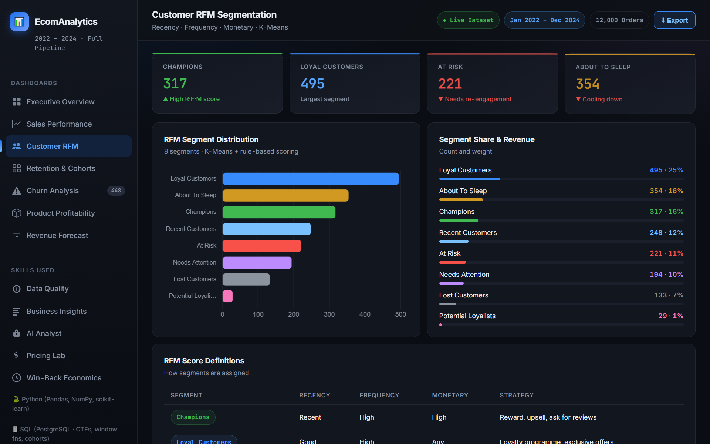
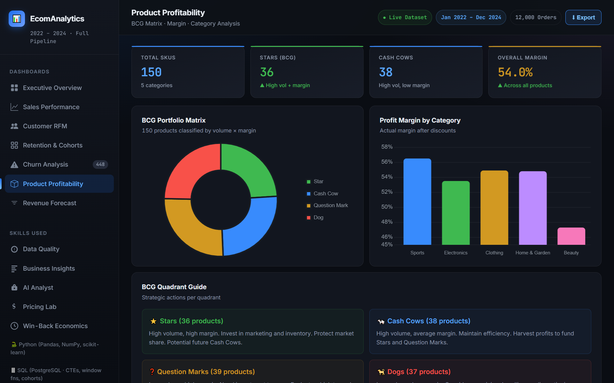
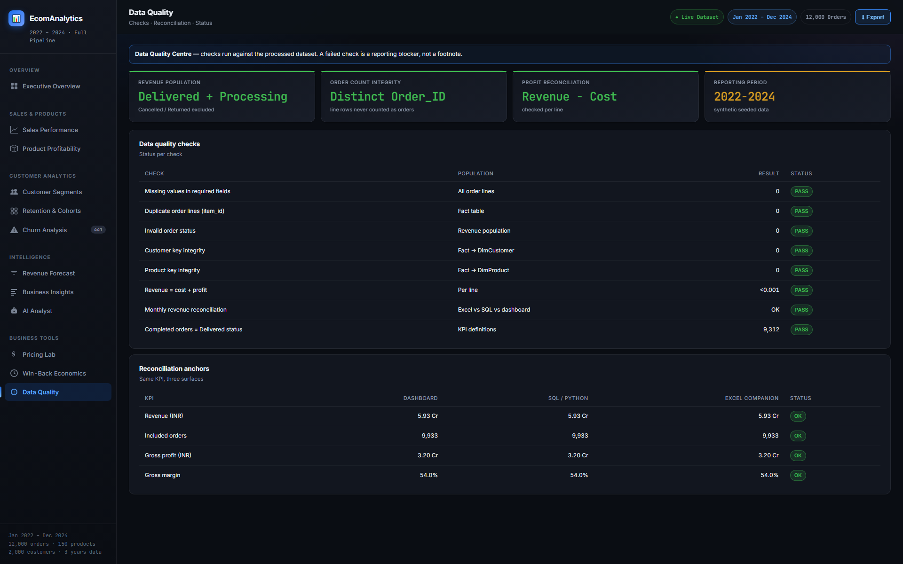
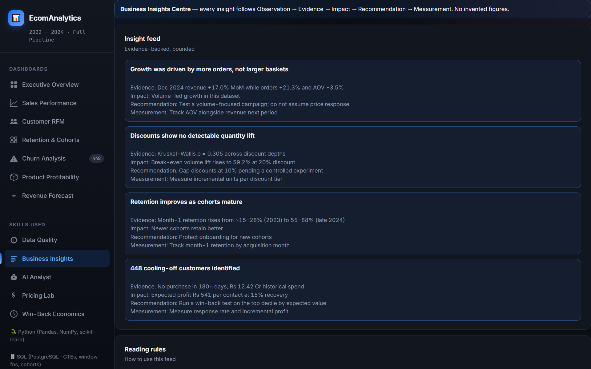
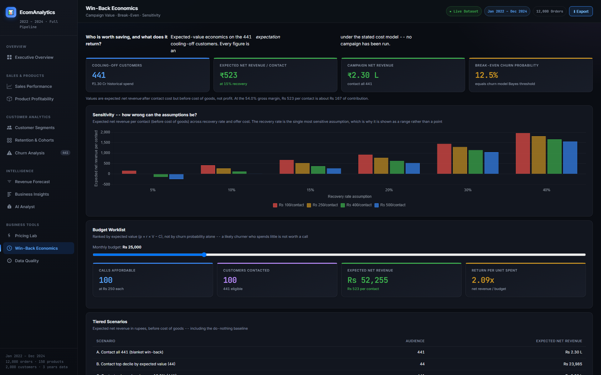
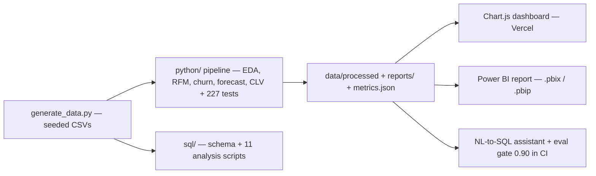

# E-Commerce Sales & Customer Analytics

<p align="center">
  <a href="https://github.com/rishi-1603/E_commerce-Sales-and-Data-Analytics">GitHub Repository</a> ·
  <a href="https://ecomanalytics-dashboard.vercel.app/">Live Web Dashboard (Vercel)</a> ·
  <a href="powerbi/pbix/EcomAnalytics.pbip">Power BI Project (PBIP)</a> ·
  <a href="powerbi/pbix/EcomAnalytics.pbix">Power BI Report (.pbix)</a>
</p>

<p align="center">
  
  
  
  
  
  <a href="https://github.com/rishi-1603/E_commerce-Sales-and-Data-Analytics/actions/workflows/ci.yml"></a>
</p>

<p align="center">
  <a href="https://ecomanalytics-dashboard.vercel.app/">
    
  </a>
  <br>
  <em>Live web dashboard preview (click to open) — Power BI Desktop editing screens are intentionally not used as the README hero image.</em>
</p>

A complete analytics project on a synthetic INR-denominated e-commerce dataset (12,000 orders, 150 products, 2,000 customers). It spans a star-schema data model, a 4-page Power BI report, a Python analytics pipeline (EDA, RFM, cohort retention, churn, forecasting, pricing, CLV), 11 SQL analysis scripts, and a static Chart.js dashboard deployed on Vercel. Core KPI definitions are centralized in `data/metrics.json` and supported by automated regression tests.

## Quickstart

```bash
pip install -r requirements.txt
python data/raw/generate_data.py && python run_pipeline.py && python -m pytest tests/ -q
```

## Project overview

The project answers four business questions end to end:

1. **Where does revenue come from?** - category, region, segment, payment method, month.
2. **Who are the customers?** - RFM + K-Means segmentation, CLV, churn risk.
3. **Do customers stick?** - first-purchase cohorts, month-over-month retention.
4. **What should we do next?** - win-back targeting, discount economics, revenue forecast.

The dataset is **synthetic and seeded** (fully reproducible via `data/raw/generate_data.py`). Methods and engineering are the substance; the numbers are illustrative and should not be read as real business performance.

## Dataset

A seeded, fully reproducible star schema covering **Jan 2022 – Dec 2024**, INR-denominated:

| Table | Rows | Grain |
|---|---|---|
| `orders.csv` | 12,000 | one row per placed order — status Delivered / Processing / Cancelled / Returned |
| `order_items.csv` | 25,384 | one row per order line — quantity, unit price, discount, cost |
| `customers.csv` | 2,000 | one row per customer record — B2B / B2C / Enterprise |
| `products.csv` | 150 | one row per SKU across 5 categories |

Regenerate it byte-identically with `python data/raw/generate_data.py`. Cleaning and validation logic lives in `sql/02_data_cleaning.sql` and `python/eda/01_eda_preprocessing.py`.

## Key performance indicators

| KPI | Value |
|---|---|
| Revenue (Delivered + Processing) | ₹59,283,619.32 |
| Cost of goods sold | ₹27,286,277.68 |
| Gross profit | ₹31,997,341.64 |
| Gross margin | 53.97% |
| Orders placed | 12,000 |
| Delivered | 9,312 (77.6%) |
| Processing | 621 (5.2%) |
| Cancelled | 844 (7.0%) |
| Returned | 1,223 (10.2%) |
| Customers | 1,991 |
| Average order value | ₹5,968.35 |

Order statuses are **mutually exclusive**: `Returned` is its own exit (10.2% of placed), not a subtraction from `Delivered`.

Full definitions — numerator, denominator, population and pinned values for the core KPIs — are documented in [`data/metrics.json`](data/metrics.json); the exact-to-the-penny values are enforced by the test suite.

## Dashboard showcase

### Power BI report (4 pages)

The report ships in two forms:

- **`powerbi/pbix/EcomAnalytics.pbix`** — compiled report with the data model embedded. Open it directly in Power BI Desktop; visuals render immediately with data, no refresh required.
- **`powerbi/pbix/EcomAnalytics.pbip`** — the editable Power BI project (PBIR format + TMDL semantic model), for development and version control.

The screenshots below are captured from the compiled report and reconcile with the KPI table above to the penny.

| Executive Overview | Sales Performance |
|---|---|
|  |  |
| **Customer Insights** | **Order Operations** |
|  |  |

- **Executive Overview** — Revenue ₹59.28M, Gross Profit ₹32.00M, Margin 53.97%, Delivered 9,312, AOV ₹5.97K, Customers 1,991; the segment table totals exactly ₹59,283,619.32 and 1,991.
- **Sales Performance** — the category reconciliation table sums to ₹59,283,619.32 revenue, ₹27,286,277.68 COGS, ₹31,997,341.64 gross profit, 53.97% margin.
- **Customer Insights** — segment economics: B2B 403 + B2C 1,379 + Enterprise 209 = 1,991 customers; blended AOV ₹5,968.35.
- **Order Operations** — statuses are mutually exclusive: 12,000 placed = 9,312 delivered + 621 processing + 844 cancelled + 1,223 returned; 10.19% of placed orders had Returned status.

### Web dashboard (Vercel)

A static Chart.js dashboard deployed at [ecomanalytics-dashboard.vercel.app](https://ecomanalytics-dashboard.vercel.app/). It is a separate artifact from the Power BI report.

This README shows sixteen dashboard views in total — the four Power BI pages above and all twelve pages of the web dashboard (the lead image at the top is the web Executive Overview; the remaining eleven are below) — each shown exactly once. The web screenshots were captured from the live Vercel deployment in November 2026 and reconcile with the KPI table above.

| Sales Performance | Customer RFM Segmentation |
|---|---|
|  |  |
| **Retention & Cohorts** | **Churn Analysis** |
|  |  |
| **Product Profitability** | **Revenue Forecast** |
|  |  |
| **Data Quality** | **Business Insights** |
|  |  |
| **AI Analyst** | **Pricing Lab & Win-Back** |
|  |  |
| **Win-Back Economics** | |
|  | |

- **Sales Performance** — 9,312 delivered (77.6% of placed); Sports is the top category, West the top region.
- **Customer RFM Segmentation** — K-Means segments over Recency · Frequency · Monetary, summing to exactly 1,991 customers.
- **Retention & Cohorts** — first-purchase cohort heatmap; month-1 retention rises from ~15–28% (2023 cohorts) to 55–88% (late-2024 cohorts).
- **Churn Analysis** — Random Forest risk scoring (AUC 0.649) flags the 448 cooling-off customers.
- **Product Profitability** — BCG matrix over all 150 products: 36 Stars, 38 Cash Cows, 39 Question Marks, 37 Dogs.
- **Revenue Forecast** — Holt-Winters + linear ensemble for Jan–Jun 2025; MASE 0.68.
- **Data Quality** — automated reconciliation checks; one known gap disclosed in place.
- **Business Insights** — every insight follows Observation → Evidence → Impact → Recommendation → Measurement, with no invented figures.
- **AI Analyst** — built-in grounded questions show the SQL and refuse unanswerable ones; "Total revenue" returns ₹5.93 Cr across 9,933 completed orders (Delivered + Processing).
- **Pricing Lab & Win-Back** — no statistically detectable volume lift across discount depths (Kruskal-Wallis p = 0.305); the 20% rung would need +59.2% volume to break even.
- **Win-Back Economics** — 448 cooling-off customers (₹1.24 Cr historical spend); ₹541 expected profit per contact at 15% recovery; 12.9% break-even churn probability.

## Tech stack

| Layer | Technology |
|---|---|
| Data generation | Python (pandas, numpy) — seeded, reproducible |
| Analytics pipeline | Python 3.11 (scikit-learn, statsmodels, scipy, matplotlib, seaborn) |
| Database | PostgreSQL (schema + analysis scripts in `sql/`) |
| API & AI analyst | FastAPI + SQLAlchemy (SQLite) with sqlglot-guarded queries; grounded NL-to-SQL assistant (`app/`, `evals/`) |
| Excel reporting | openpyxl-authored workbooks with live formulas — `Ecommerce_BI_Companion.xlsx` + `EcomAnalytics_Business_Reporting.xlsx` (`powerbi/`) |
| BI modelling | Power BI semantic model via TMDL; DAX measure dictionary + Power Query M transformations (`powerbi/`) |
| Reporting | Power BI Desktop (PBIR format) |
| Web dashboard | Chart.js, static HTML on Vercel |
| Containerization | Docker (`Dockerfile`, `docker-compose.yml`) |
| Migrations | Alembic (SQLAlchemy) |
| Testing | pytest (227 tests) + flake8 + NL-to-SQL eval gate |
| CI | GitHub Actions |

## Skills demonstrated

Every technology above is applied, not listed — each deliverable exercises it:

| Deliverable | Skills it proves |
|---|---|
| Python pipeline (8 steps) | pandas / NumPy wrangling, RFM + K-Means segmentation, cohort retention, churn classification, CLV, time-series forecasting |
| Statistical analysis | SciPy hypothesis testing (t-test, ANOVA, χ², Kruskal-Wallis), discount elasticity break-even math |
| 11 SQL scripts | PostgreSQL star schema, CTEs, window functions, cohort and funnel queries, returns analysis |
| Power BI (.pbix / .pbip) | TMDL semantic modeling, DAX measures at order-line grain, Power Query M transforms, 4-page report design |
| Excel workbooks | openpyxl automation, live-formula executive models, monthly reconciliation tables |
| FastAPI + NL-to-SQL | REST API design, SQLAlchemy, sqlglot injection guarding, LLM grounding with verified fact sheet + refusals |
| Chart.js dashboard | static-site deployment (Vercel), responsive layout, WCAG-conscious markup |
| 227 pytest tests | regression discipline — every displayed KPI pinned to the computed layer |
| CI pipeline | GitHub Actions gates: pytest + flake8 + eval accuracy ≥ 0.90 |
| Docker | containerized app deployment (`Dockerfile`, `docker-compose.yml`) |

## Repository structure

```
.
├── data/                  # raw + processed CSVs, metrics.json (semantic layer)
├── python/                # analytics pipeline (eda, segmentation, churn, forecast, ...)
├── sql/                   # database schema + 11 analysis scripts
├── app/                   # FastAPI service — REST endpoints + grounded NL-to-SQL query API
├── evals/                 # NL-to-SQL benchmark + eval runner (CI accuracy gate)
├── powerbi/pbix/          # PBIP project (semantic model + report) and compiled .pbix
├── dashboard/             # Chart.js dashboard (source)
├── dashboard.html / index.html   # deployed web dashboard copies (kept byte-identical)
├── scripts/               # decision_layer, calibration, backtest, challenger, dashboard injection
├── tests/                 # pytest suite (227 tests)
├── reports/               # generated JSON + markdown reports
├── docs/                  # figures, screenshots, specs and audit documents
└── run_pipeline.py        # pipeline entry point
```

## Architecture



## How to run locally

### Prerequisites

- Python 3.11
- (Optional) Power BI Desktop for the `.pbip`

### Installation

```bash
git clone https://github.com/rishi-1603/E_commerce-Sales-and-Data-Analytics.git
cd E_commerce-Sales-and-Data-Analytics
python -m venv .venv
# Windows
.venv\Scripts\activate
# macOS / Linux
source .venv/bin/activate
pip install -r requirements.txt
```

### Running the pipeline

```bash
python data/raw/generate_data.py   # regenerate synthetic data
python run_pipeline.py              # 8-step analytics pipeline
python -m pytest tests/ -v         # 227 tests
```

### Power BI report

Open `powerbi/pbix/EcomAnalytics.pbip` in Power BI Desktop, then click **Refresh now** to load the CSVs.

## Testing and validation

```bash
python -m pytest tests/ -v
```

All 227 tests pass. The suite pins KPI values (revenue, COGS, profit, margin, order counts), the discount break-even ladder, the funnel, cohort retention, churn calibration, forecast backtest, and the dashboard's embedded `DATA` block against the computed layer.

## Grounded AI analyst

A natural-language-to-SQL assistant (`scripts/nl_to_sql.py`) answers data questions in two modes: a **deterministic grounded path** used by CI (no external LLM key needed) and an optional LLM path that is scored separately. Alongside it, the FastAPI app (`app/`) exposes a query endpoint whose SQL executes behind a sqlglot AST guard — SELECT-only, whitelisted tables, enforced `LIMIT 100` — so mutating or off-scope statements are refused.

Evaluation is independent by design: ground truth is computed with pandas straight from `data/processed/master_orders.csv`, never from the system under test, and refusals are scored on their own — an unanswerable question answered with a number is penalised harder than an admission. Benchmark v1.1 (37 questions): **36/37 = 97.3% execution accuracy, 100% refusal correctness, 0 fabricated numbers** (`mode=fallback`). CI fails below the 0.90 accuracy gate. Full report: `reports/ai_eval_report.md`.

## Key business findings

- **Revenue concentration**: top 10% of customers hold ~42% of projected lifetime value (observed concentration in this synthetic population).
- **Discount analysis did not detect a statistically significant overall quantity response**: Kruskal-Wallis p = 0.305; break-even requires 10.61% / 23.12% / 38.14% / 59.24% volume lift at 5% / 10% / 15% / 20% depth.
- **Returned orders warrant further investigation**: 1,223 returned orders (10.19% of the 12,000 placed), concentrated in a few categories.
- **Cohort retention improved**: month-1 retention rose from ~15-28% (2023 cohorts) to 55-88% (late 2024) - an observed cohort difference, not a proven intervention effect.
- **Forecast is honest about its limits**: ensemble MASE 0.68 loses to the drift baseline (0.468); shipped bootstrap CI covers only 9.5% of actuals.

### Discount break-even ladder

| Discount depth | Margin % of list | Break-even volume lift |
|---|---|---|
| 0% | 53.79% | 0.00% |
| 5% | 48.63% | 10.61% |
| 10% | 43.69% | 23.12% |
| 15% | 38.94% | 38.14% |
| 20% | 33.78% | 59.24% |

## Limitations

- The dataset is **synthetic**; all figures are illustrative and methods are the deliverable.
- The win-back experiment is a **design only** - no campaign has been run.
- The discount and returns analyses are **observational** — association, not causation.
- The revenue forecast assumes trend/seasonality continue and underestimates variance.
- The churn model (AUC 0.65) is a targeting tool, not a per-customer oracle.

## Future improvements

- Run the win-back experiment as designed and validate the forecast against real actuals.
- Retrain churn monthly with a temporal backtest.
- Add a real (non-synthetic) data source and re-run the pipeline.

## Author

Rishi - [GitHub](https://github.com/rishi-1603) · [Repository](https://github.com/rishi-1603/E_commerce-Sales-and-Data-Analytics)
