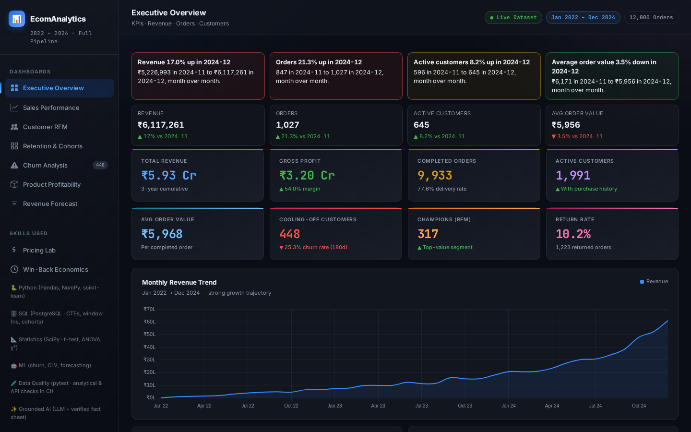
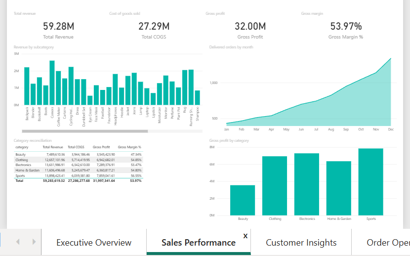
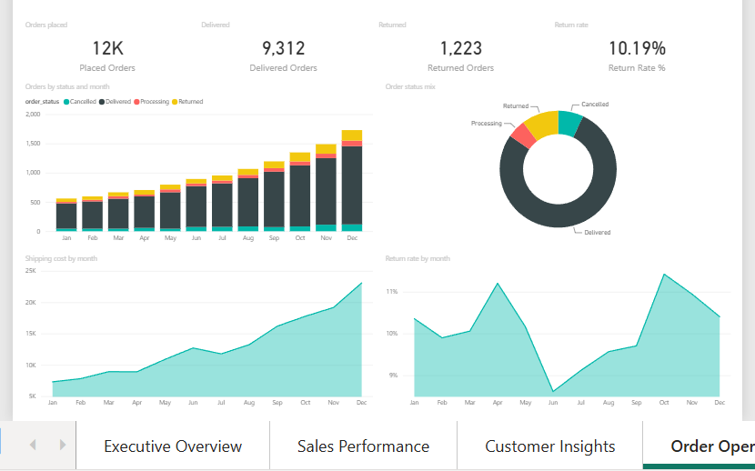
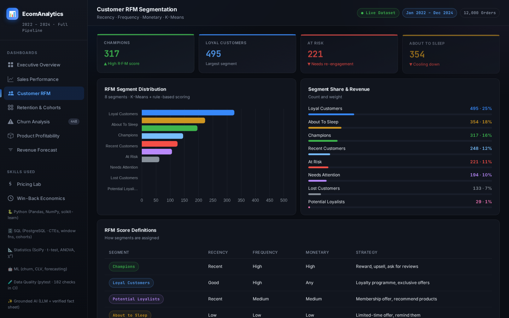
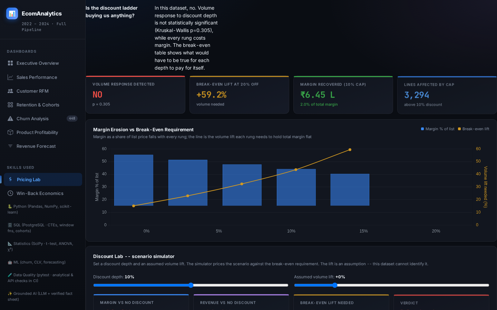

# E-Commerce Sales & Customer Analytics

<p align="center">
  <a href="https://github.com/rishi-1603/E_commerce-Sales-and-Data-Analytics">GitHub Repository</a> ·
  <a href="https://ecomanalytics-dashboard.vercel.app/">Live Web Dashboard (Vercel)</a> ·
  <a href="powerbi/pbix/EcomAnalytics.pbip">Power BI Project (PBIP)</a> ·
  <a href="powerbi/pbix/EcomAnalytics.pbix">Power BI Report (.pbix)</a>
</p>

<p align="center">
  
  <br>
  <em>Live web dashboard preview — Power BI Desktop editing screens are intentionally not used as the README hero image.</em>
</p>

A complete analytics project on a synthetic INR-denominated e-commerce dataset (12,000 orders, 150 products, 2,000 customers). It spans a star-schema data model, a 4-page Power BI report, a Python analytics pipeline (EDA, RFM, cohort retention, churn, forecasting, pricing, CLV), 11 SQL analysis scripts, and a static Chart.js dashboard deployed on Vercel. Every KPI is defined once in `data/metrics.json` and pinned by 227 tests.

## Project overview

The project answers four business questions end to end:

1. **Where does revenue come from?** - category, region, segment, payment method, month.
2. **Who are the customers?** - RFM + K-Means segmentation, CLV, churn risk.
3. **Do customers stick?** - first-purchase cohorts, month-over-month retention.
4. **What should we do next?** - win-back targeting, discount economics, revenue forecast.

The dataset is **synthetic and seeded** (fully reproducible via `data/raw/generate_data.py`). Methods and engineering are the substance; the numbers are illustrative and should not be read as real business performance.

## Key performance indicators

| KPI | Value |
|---|---|
| Revenue (Delivered + Processing) | ₹59,283,619.32 |
| Cost of goods sold | ₹27,286,277.68 |
| Gross profit | ₹31,997,341.64 |
| Gross margin | 53.97% |
| Orders placed | 12,000 |
| Delivered | 9,312 (77.6%) |
| Processing | 621 (5.2%) |
| Cancelled | 844 (7.0%) |
| Returned | 1,223 (10.2%) |
| Customers | 1,991 |
| Average order value | ₹5,968.35 |

Order statuses are **mutually exclusive**: `Returned` is its own exit (10.2% of placed), not a subtraction from `Delivered`.

## Dashboard showcase

### Power BI report (4 pages)

The report ships in two forms:

- **`powerbi/pbix/EcomAnalytics.pbix`** — compiled report with the data model embedded. Open it directly in Power BI Desktop; visuals render immediately with data, no refresh required.
- **`powerbi/pbix/EcomAnalytics.pbip`** — the editable Power BI project (PBIR format + TMDL semantic model), for development and version control.

The screenshots below are captured from the compiled report and reconcile with the KPI table above to the penny.

| Executive Overview | Sales Performance |
|---|---|
|  |  |
| **Customer Insights** | **Order Operations** |
|  |  |

- **Executive Overview** — Revenue ₹59.28M, Gross Profit ₹32.00M, Margin 53.97%, Delivered 9,312, AOV ₹5.97K, Customers 1,991; the segment table totals exactly ₹59,283,619.32 and 1,991.
- **Sales Performance** — the category reconciliation table sums to ₹59,283,619.32 revenue, ₹27,286,277.68 COGS, ₹31,997,341.64 gross profit, 53.97% margin.
- **Customer Insights** — segment economics: B2B 403 + B2C 1,379 + Enterprise 209 = 1,991 customers; blended AOV ₹5,968.35.
- **Order Operations** — statuses are mutually exclusive: 12,000 placed = 9,312 delivered + 621 processing + 844 cancelled + 1,223 returned; return rate 10.19% of placed orders.

### Web dashboard (Vercel)

A static Chart.js dashboard deployed at [ecomanalytics-dashboard.vercel.app](https://ecomanalytics-dashboard.vercel.app/). It is a separate artifact from the Power BI report.





## Tech stack

| Layer | Technology |
|---|---|
| Data generation | Python (pandas, numpy, Faker) |
| Analytics pipeline | Python 3.11 (scikit-learn, statsmodels, matplotlib, seaborn) |
| Database | PostgreSQL (analysis scripts in `sql/`) |
| BI modelling | Power BI semantic model via TMDL (`powerbi/pbix/EcomAnalytics.SemanticModel/`) |
| Reporting | Power BI Desktop (PBIR format) |
| Web dashboard | Chart.js, static HTML on Vercel |
| Testing | pytest (227 tests) |
| CI | GitHub Actions |

## Repository structure

```
.
├── data/                  # raw + processed CSVs, metrics.json (semantic layer)
├── python/                # analytics pipeline (eda, segmentation, churn, forecast, ...)
├── sql/                   # 11 analysis scripts
├── powerbi/pbix/          # PBIP project (semantic model + report)
├── dashboard/             # Chart.js dashboard (source)
├── dashboard.html / index.html   # deployed web dashboard
├── scripts/               # decision_layer, calibration, backtest, challenger
├── tests/                 # pytest suite
├── reports/               # generated JSON + markdown reports
├── docs/                  # figures, screenshots, architecture
└── run_pipeline.py        # pipeline entry point
```

## How to run locally

### Prerequisites

- Python 3.11
- (Optional) Power BI Desktop for the `.pbip`

### Installation

```bash
git clone https://github.com/rishi-1603/E_commerce-Sales-and-Data-Analytics.git
cd E_commerce-Sales-and-Data-Analytics
python -m venv .venv
# Windows
.venv\Scripts\activate
# macOS / Linux
source .venv/bin/activate
pip install -r requirements.txt
```

### Running the pipeline

```bash
python data/raw/generate_data.py   # regenerate synthetic data
python run_pipeline.py              # 8-step analytics pipeline
python -m pytest tests/ -v         # 227 tests
```

### Power BI report

Open `powerbi/pbix/EcomAnalytics.pbip` in Power BI Desktop, then click **Refresh now** to load the CSVs.

## Testing and validation

```bash
python -m pytest tests/ -v
```

All 227 tests pass. The suite pins KPI values (revenue, COGS, profit, margin, order counts), the discount break-even ladder, the funnel, cohort retention, churn calibration, forecast backtest, and the dashboard's embedded `DATA` block against the computed layer.

## Key business findings

- **Revenue concentration**: top 10% of customers hold ~42% of projected lifetime value (observed concentration in this synthetic population).
- **Discounts don't pay for themselves**: no volume response detected (Kruskal-Wallis p = 0.305); break-even requires 10.61% / 23.12% / 38.14% / 59.24% volume lift at 5% / 10% / 15% / 20% depth.
- **Returns are a quality problem**: 1,223 returned orders (10.2% of placed), concentrated in a few categories.
- **Cohort retention improved**: month-1 retention rose from ~15-28% (2023 cohorts) to 55-88% (late 2024) - an observed cohort difference, not a proven intervention effect.
- **Forecast is honest about its limits**: ensemble MASE 0.68 loses to the drift baseline (0.468); shipped bootstrap CI covers only 9.5% of actuals.

### Discount break-even ladder

| Discount depth | Margin % of list | Break-even volume lift |
|---|---|---|
| 0% | 53.79% | 0.00% |
| 5% | 48.63% | 10.61% |
| 10% | 43.69% | 23.12% |
| 15% | 38.94% | 38.14% |
| 20% | 33.78% | 59.24% |

## Limitations

- The dataset is **synthetic**; all figures are illustrative and methods are the deliverable.
- The win-back experiment is a **design only** - no campaign has been run.
- The revenue forecast assumes trend/seasonality continue and underestimates variance.
- The churn model (AUC 0.65) is a targeting tool, not a per-customer oracle.

## Future improvements

- Run the win-back experiment as designed and validate the forecast against real actuals.
- Retrain churn monthly with a temporal backtest.
- Add a real (non-synthetic) data source and re-run the pipeline.

## Author

Rishi - [GitHub](https://github.com/rishi-1603) · [Repository](https://github.com/rishi-1603/E_commerce-Sales-and-Data-Analytics)
