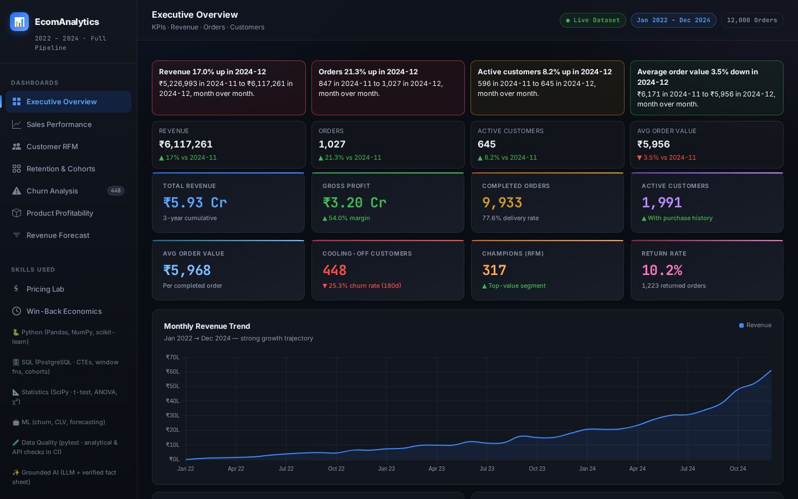
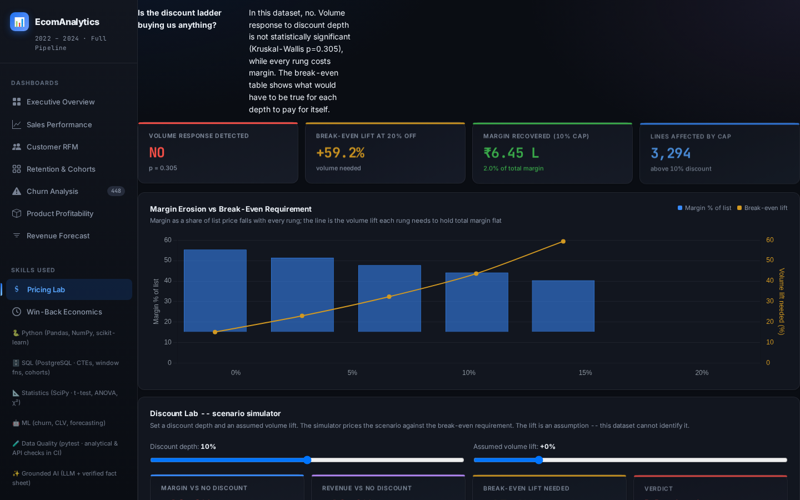

# E-Commerce Sales & Customer Analytics

Sales, customer retention and pricing analysis for a simulated retailer. The project follows a question a commercial team would ask in a review meeting: **what changed, why does it matter, and what should we investigate next?**

[Open the dashboard](https://ecomanalytics-dashboard.vercel.app/) · [SQL analysis](sql/README.md) · [Executive findings](docs/EXECUTIVE_FINDINGS_REPORT.md) · [Data dictionary](data/DATA_DICTIONARY.md)

[](https://github.com/rishi-1603/E_commerce-Sales-and-Data-Analytics/actions/workflows/ci.yml)



> The data is synthetic and seeded. The findings below describe this dataset, not an actual retailer. Financial scenarios are estimates under stated assumptions—not measured savings or campaign results.

## What the analysis covers

The dataset contains 12,000 orders across 2022–2024, a 2,000-customer source table and 150 products. Of those customers, 1,991 appear in the analytical purchase population. Orders and order lines are kept separate so joins do not inflate order counts or average order value.

The dashboard brings together sales trends, RFM segments, retention cohorts, churn analysis, product profitability, forecasting, discount scenarios and win-back economics. It is intended for commercial, retention and merchandising teams reviewing where to focus their attention.

## Findings worth discussing

### Growth was driven by more orders, not larger baskets

In December 2024, revenue increased **17.0%** month over month and orders increased **21.3%**, while average order value fell **3.5%**. That points to volume-led growth in this dataset. It does not establish which campaign or channel caused it.

### Discounts need a stronger case than higher sales

There was no statistically detectable overall quantity difference across discount depths (Kruskal–Wallis **p = 0.305**). Meanwhile, the volume lift needed to preserve margin increases sharply:

| Discount | Required break-even volume lift |
|---|---:|
| 5% | 10.6% |
| 10% | 23.1% |
| 15% | 38.1% |
| 20% | 59.2% |

A 10% discount-cap scenario adds approximately **₹6.45 lakh** of margin if volume stays unchanged. That is a scenario to test, not a recommendation to assume customers will behave the same after a price change.



[Discount calculations](reports/discount_analysis.json) · [Pricing SQL](sql/12_discount_margin.sql)

### A retention campaign needs a break-even rule

The win-back analysis covers **448 cooling-off customers**. Under the documented contact-cost, response and customer-value assumptions, expected profit is **₹541 per contact**, or approximately **₹2.42 lakh** across the pool. The sensitivity analysis shows how those estimates move when the assumptions change.

[Win-back economics](reports/winback_economics.json) · [Experiment design](docs/experiment_design_winback.md)

### The first forecast was not the best forecast

The original ensemble lost to a drift baseline: MASE **0.680** versus **0.468**. A challenger comparison using the same evaluation protocol found `holt_linear` at **0.3752**, about **19.8% lower error than drift**. The losing results remain in the report. Forecast intervals also need caution: the original nominal 95% interval was substantially under-covered.

[Forecast comparison and protocol](reports/forecast_challenger.md) · [Original backtest](reports/forecast_backtest.md)

## How the numbers are produced

```text
Seeded source tables
    → cleaning, joins and validation
    → order-line analytical table
    → SQL/Python analyses and report artifacts
    → dashboard and supporting API
```

Revenue and profit use **Delivered + Processing** orders, excluding Cancelled and Returned orders. That is the project's reporting convention, not an accounting standard. Customer counts, funnel measures and retention cohorts use their own documented populations.

- **SQL:** schema, data-quality queries, sales and customer analysis, cohorts, order funnel and discount economics.
- **Python:** pandas/NumPy transformations, segmentation, statistical comparisons, churn evaluation and rolling-origin forecast backtests.
- **BI documentation:** [star-schema design](powerbi/model_diagram.md), [DAX measures](powerbi/dax_measures.md) and [reconciliation matrix](powerbi/reconciliation_matrix.csv). These are design artifacts; they are not a claim of a deployed Power BI report.
- **Validation:** data-quality, metric, dashboard and API tests. The audited suite contains **197 tests**; passing tests cover the checked cases, not every possible production interaction.

[Metric definitions](data/metrics.json) · [Data-quality scorecard](docs/DATA_QUALITY_SCORECARD.md) · [Evidence index](RESUME_EVIDENCE.md)

## Analytical assistant and API

The natural-language-to-SQL assistant retrieves database results rather than asking a language model to calculate totals. On the authored 37-question fallback benchmark, execution accuracy improved from **18/37 to 36/37**; refusal correctness reached **100%**, with no fabricated answers in the tested cases. This is a bounded evaluation, not a guarantee for arbitrary questions.

The repository also includes a FastAPI service for analytics, order records and analytical queries. It supports local SQLite execution and a PostgreSQL configuration. The public dashboard is a static HTML/Chart.js application; it should not be mistaken for proof that the API is publicly deployed.

[Assistant evaluation](reports/ai_eval_report.md) · [API documentation](docs/API_DOCUMENTATION.md)

## Run locally

Use Python 3.11, matching CI. From the repository root:

```bash
python -m venv .venv
source .venv/bin/activate
# Windows: .venv\Scripts\activate
python -m pip install -r requirements.txt

# Open dashboard/dashboard.html in a browser for the included dashboard.

# Rebuild the seeded data and analytical outputs
python data/raw/generate_data.py
python run_pipeline.py

# Run the tests
python -m pytest -q

# Optional: start the local API
uvicorn app.main:app --reload --port 8000
```

After starting the API, its local documentation is at `http://localhost:8000/docs`. The default database is local SQLite. PostgreSQL configuration uses `DATABASE_URL` and `SYNC_DATABASE_URL`; see the API documentation before changing them. The core pipeline and included dashboard do not require an AI API key. Keep optional provider credentials outside Git.

Additional report-generation commands and local-demo guidance are in the [demo guide](docs/DEMO_FALLBACK_GUIDE.md).

## Repository guide

| Path | Contents |
|---|---|
| `data/` | Source tables, processed outputs, dictionary and metric registry |
| `sql/` | Schema and business-analysis queries |
| `python/` | Cleaning, customer/product analysis, statistics, forecasting and pricing |
| `scripts/`, `evals/` | Report generation, calibration, backtests and assistant evaluation |
| `dashboard/` | Interactive dashboard and screenshots |
| `app/` | Supporting API, services and database access |
| `powerbi/` | Model and measure documentation |
| `tests/` | Analytical, dashboard and API regression tests |
| `reports/`, `docs/` | Findings, methods, assumptions and verification evidence |

## What I would validate before using this in a business

The next step would be real transaction data and a controlled campaign or pricing experiment—not another model. Observational discount comparisons do not identify causal demand response. CLV is a proxy, churn depends on the specified observation window, and a forecast backtest does not establish future performance. Some forecasting fits emit convergence warnings, which remain visible.

The [publication audit](docs/FINAL_RELEASE_AUDIT.md) records the checks performed and the gaps: full PostgreSQL-library execution, exhaustive filter/export/provider testing, accessibility and load testing are not certified. The [assumptions register](reports/assumptions_and_limitations.md) contains the analytical caveats.
