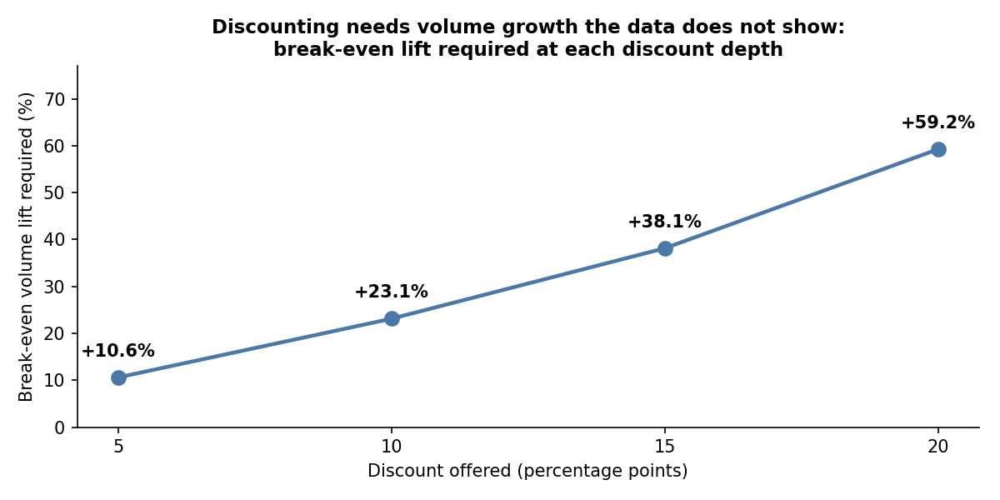
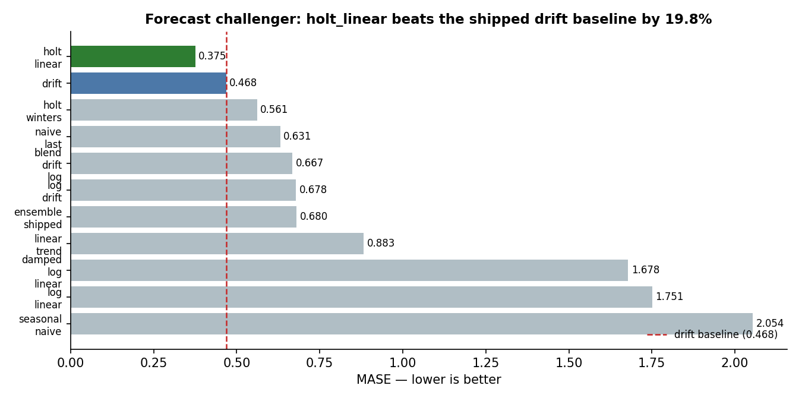
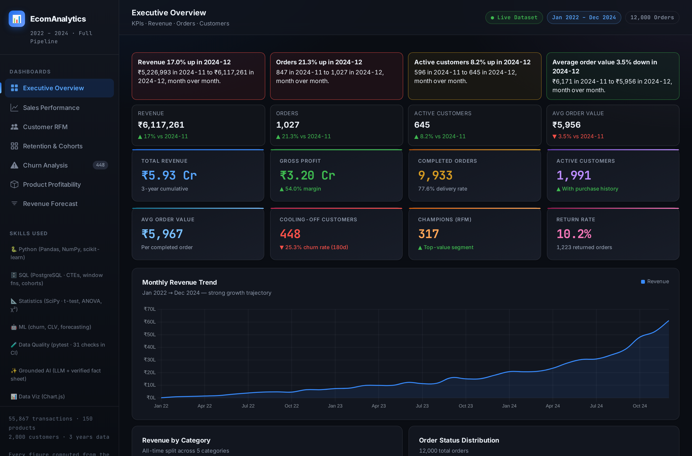
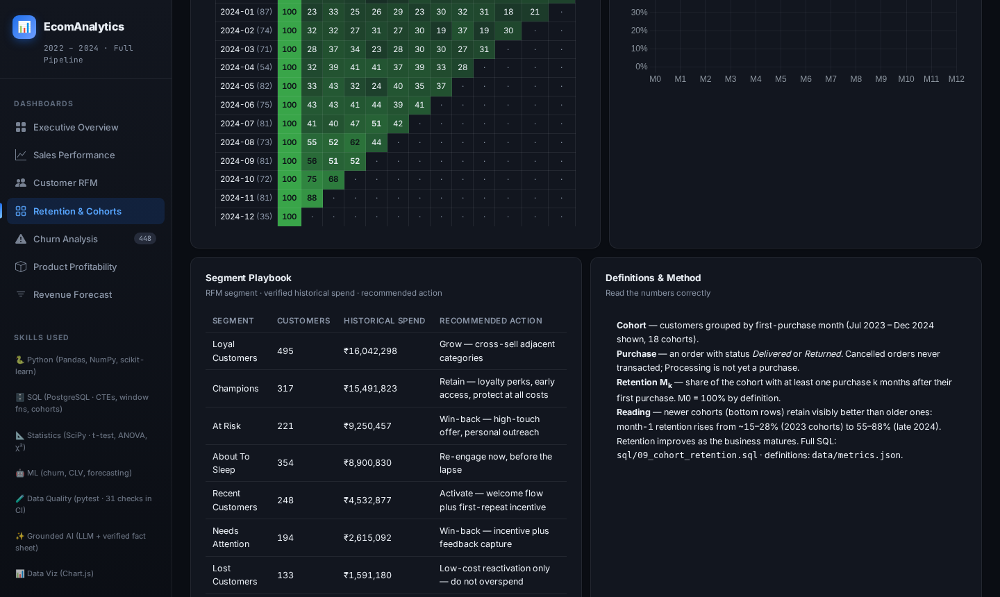

# E-Commerce Sales & Customer Analytics + Commerce Intelligence API

**An analytics-first and backend engineering portfolio project** that turns three years of synthetic e-commerce transactions into reconciled KPIs, production REST APIs, decision-ready reporting, and an AST-secured natural-language analytical query service.

[Live dashboard](https://ecomanalytics-dashboard.vercel.app/) (public — no login) · [API Docs (Swagger)](http://localhost:8000/docs) · [SQL analysis](sql/README.md) · [Executive brief](reports/executive_summary.md) · [Decision log](reports/decision_log.md) · [Data dictionary](data/DATA_DICTIONARY.md) · [Tests](tests/) · [Release gates](docs/RELEASE_GATES.md)

[](https://github.com/rishi-1603/E_commerce-Sales-and-Data-Analytics/actions/workflows/ci.yml) 

> ### 🧭 Recruiter & Interview Verification Hub (October 2026 Comprehensive Upgrade)
> - **Direct Resume Evidence Index:** [RESUME_EVIDENCE.md](RESUME_EVIDENCE.md) *(Claims, definitions, reproduction commands, & test files)*
> - **Executive Business Findings:** [docs/EXECUTIVE_FINDINGS_REPORT.md](docs/EXECUTIVE_FINDINGS_REPORT.md) *(Retention exposure, price elasticity, & recommendations)*
> - **Power BI Star Schema & DAX:** [powerbi/dax_measures.md](powerbi/dax_measures.md) | [powerbi/model_diagram.md](powerbi/model_diagram.md) | [powerbi/reconciliation_matrix.csv](powerbi/reconciliation_matrix.csv)
> - **Data Quality Scorecard:** [docs/DATA_QUALITY_SCORECARD.md](docs/DATA_QUALITY_SCORECARD.md) *(Null, duplicate, FK, & boundary sanity checks)*
> - **API Architecture & Security:** [docs/API_DOCUMENTATION.md](docs/API_DOCUMENTATION.md) *(REST endpoints & AST-secured NL-to-SQL copilot)*
> - **Offline Demo Fallback Guide:** [docs/DEMO_FALLBACK_GUIDE.md](docs/DEMO_FALLBACK_GUIDE.md) *(Local instant execution & smoke-test instructions)*

---


**196 automated tests** (183 analytical, dashboard & econometric tests + 13 backend API integration tests) check analytical outputs, dashboard consistency and API behavior. Tests do not by themselves establish that every production interaction or figure is correct.

> **Data and claims notice:** The transaction data is seeded and synthetic. Figures below are reproducible outputs from that dataset—not observed company results, causal effects, realized savings, or campaign outcomes. Methods are demonstrated; business conclusions require validation on real data.

---

## ⚡ Commerce Intelligence API *(Backend Engineering Layer)*

A high-performance Python and PostgreSQL/SQLite backend service built with **FastAPI**, **SQLAlchemy ORM**, **Pydantic v2**, and **Alembic**, exposing production-grade REST endpoints with transactional safety and AST-verified security.

```
[System Architecture]
├── Client Layer: Web Dashboard (Vercel) / Mobile App / BI Clients
│   └── HTTP REST Requests (with optional Idempotency-Key & X-Request-ID headers)
├── FastAPI Application Gateway (app/main.py)
│   ├── Structured Logging & Latency Tracing Middleware
│   ├── Pydantic v2 Request/Response Validation Layer
│   ├── Business Services (app/services/analytics_service.py, order_service.py)
│   └── AST-Based SQL Query Sanitizer (sqlglot parsing in app/services/query_service.py)
└── Persistence Layer (app/db/session.py)
    ├── SQLite (zero-config local run & testing)
    ├── PostgreSQL (production containerized mode via Docker Compose)
    └── Alembic Schema Migrations (migrations/)
```

### Key API Endpoints

| Method | Endpoint | Description | Production Safeguard |
|---|---|---|---|
| GET | /health | System health and database connectivity | Verifies active DB ping |
| GET | /api/v1/analytics/overview | Reconciled executive KPIs (Revenue, Orders, AOV, Cancellations) | Strict valid-orders rule (Delivered + Processing only) |
| GET | /api/v1/analytics/trends | Monthly revenue, order count, and AOV trends | Dimension aggregation without inflated joins |
| GET | /api/v1/analytics/top-products | Top SKUs by revenue, profit, and gross margin % | Parameterized limit with input boundaries |
| GET | /api/v1/orders | Paginated order history with status & customer filtering | Limit/offset bounds preventing memory overflows |
| GET | /api/v1/orders/{order_id} | Full order breakdown including line items | 404 error handling for missing identifiers |
| POST | /api/v1/orders | Atomic order & line-item creation | **Idempotency-Key deduplication** + atomic rollback |
| POST | /api/v1/query/nl-to-sql | Grounded Natural Language to SQL analytics assistant | **AST parser (sqlglot)** blocking mutations & non-whitelisted tables |

### Backend Engineering Highlights
1. **Idempotency & Atomic Transactions:** POST /api/v1/orders supports an Idempotency-Key header. Duplicate retries return cached responses without duplicate DB inserts. Multi-table writes (orders + order_items) roll back atomically on any failure.
2. **AST-Based SQL Sanitization:** Natural language queries are parsed into Abstract Syntax Trees using sqlglot. Only root SELECT queries on whitelisted tables are permitted; mutating statements (DROP, DELETE, UPDATE, ALTER) are blocked at the grammar level, and LIMIT 100 is injected automatically.
3. **Multi-Stage Containerization:** Production Dockerfile and docker-compose.yml orchestrating FastAPI with PostgreSQL 15, healthchecks, and volume persistence.

### Quickstart (Run API Locally)
`ash
# 1. Clone repository & install dependencies
git clone https://github.com/rishi-1603/E_commerce-Sales-and-Data-Analytics.git
cd E_commerce-Sales-and-Data-Analytics
pip install -r requirements.txt

# 2. Run API server (automatically creates & seeds local SQLite DB on first run)
uvicorn app.main:app --reload --host 0.0.0.0 --port 8000

# 3. Open interactive Swagger documentation in browser
# http://localhost:8000/docs

# 4. Run automated test suite
python -m pytest tests/api -v
```

## Executive summary

---

## 💰 Pricing & Campaign Economics *(v2 upgrade — the pricing-analyst layer)*

> The dashboard now prices decisions, not just describes them. Two new pages turn
> questions that usually end in an opinion into numbers that can be falsified.

| Question | Answer | Where |
|---|---|---|
| Is our discount ladder buying volume? | **No measurable response** — Kruskal-Wallis p=0.305; quantity is flat at ~3.0 units at every depth | Pricing Lab |
| What would a discount need to earn its keep? | **+10.6% / +23.1% / +38.1% / +59.2%** volume at 5/10/15/20% off, just to hold margin flat | Pricing Lab — break-even table |
| What is the deep ladder costing? | Capping at 10% recovers **₹6.45 L of margin (2.0%)** across 3,294 line items, volume held constant | Pricing Lab — repricing scenario |
| Is the cooling-off pool worth calling? | **₹541 expected profit per contact**, ₹2.42 L across all 448 customers | Win-Back Economics |
| Where is the break-even on churn risk? | **12.89%** — which equals the churn model's own Bayes threshold, computed independently | Win-Back — consistency check |



**The two findings that matter, stated plainly:**

1. **The discount ladder is a margin policy, not a demand lever.** On this data, deeper
   discounts do not sell more units. The one "statistically significant" category
   (Sports, p=0.003) moves **−6.96%** — the wrong direction. Significance is not
   materiality, and the report says so.
2. **The published forecast loss is now resolved.** The shipped ensemble lost to a drift
   baseline (MASE 0.680 vs 0.468). A challenger sweep — same protocol, imported
   baselines — found **`holt_linear` at MASE 0.3752, 20% better than drift**. The
   reason: seasonality *hurts* on this dataset (seasonal-naive 2.05, Holt-Winters 0.56).
   The recommendation changed because the evidence did.

📄 [`reports/discount_analysis`](reports/) · [`reports/winback_economics.json`](reports/winback_economics.json) · [`reports/forecast_challenger.md`](reports/forecast_challenger.md)

---

## 🧪 AI Evaluation *(v2 upgrade)*

The NL-to-SQL assistant is now **measured, not asserted**. A 37-question benchmark
(4 classes, including refusal cases) runs in CI against independent ground truth:

| Metric | Before this work | Now |
|---|---|---|
| Execution accuracy | 18/37 = **48.6%** | **36/37 = 97.3%** |
| Fabricated answers on unanswerable questions | **1** | **0** |
| Refusal correctness | 80% | **100%** |

The first run found two real defects: a question about *next year's* revenue returned
all-time historical revenue as if it were a forecast, and *"revenue in 2024"* silently
dropped the year filter. Both are fixed and pinned by regression tests.
📄 [`reports/ai_eval_report.md`](reports/ai_eval_report.md)

---

## 🎯 Decision Layer *(2026 upgrade)*




This repository answers a practical set of commercial questions: what changed in sales, which customers and products deserve attention, where orders exit the funnel, and whether promotions or forecasts support a decision. The main deliverable is an analytics workflow—data definitions, SQL and Python analyses, an interactive dashboard, documented recommendations, and automated checks. Predictive models are included as a supporting layer, not as the headline.

**Role emphasis:** Data Analyst first (SQL, KPI design, trend and cohort analysis, dashboarding, decision support); applied Data Science second (churn evaluation, calibration, forecasting backtests, and a measured natural-language-to-SQL benchmark).

| Area | Evidence from the project | Business interpretation |
|---|---|---|
| Sales movement | December 2024 revenue **+17.0%**, orders **+21.3%**, active customers **+8.2%**, AOV **−3.5%** month over month | The change is volume-led in this dataset; it is not evidence that a specific campaign caused growth. |
| Order funnel | **12,000** placed → **9,312** delivered → **8,089** kept | A funnel view makes cancellation, processing, and return exits visible. |
| Customer retention | 18 first-purchase cohorts; observed month-1 retention varies across cohorts | Compare like-for-like cohort windows before allocating retention effort. |
| Discount economics | No statistically detectable overall quantity response by discount depth (**Kruskal–Wallis p = 0.305**); break-even lift rises from **10.6%** at a 5% discount to **59.2%** at 20% | Do not recommend blanket discounting from these observational synthetic data; test a policy causally. |
| Forecast evaluation | Rolling-origin ensemble MASE **0.680** versus drift baseline **0.468** — the shipped ensemble lost. A challenger sweep then found `holt_linear` at **MASE 0.3752**, **19.8% better than drift**; nominal 95% interval covered **9.5%** of evaluated points | The original ensemble was not planning-ready and the loss is kept on record. Seasonality *hurts* on this dataset (seasonal-naive 2.05, Holt-Winters 0.56), so the honest fix is a trend model without seasonality — still validated on synthetic data only. |

## Project experience

### 1. Business questions and analytical outputs

| Stakeholder question | Analysis / artifact | Decision it can inform |
|---|---|---|
| Is revenue changing because of order volume, customer count, or basket size? | Monthly KPI variance and MoM decomposition (`sql/10_mom_variance.sql`) | Investigate the driver before changing acquisition or pricing strategy. |
| Which customers need a different retention treatment? | RFM segmentation, cohort retention, churn-risk bands, and a win-back experiment design | Prioritize a controlled test; the experiment is designed, **not run**. |
| Which products contribute to the catalog's economics? | SKU-level profitability, category margins, and BCG-style portfolio view | Review low-margin items and protect profitable assortment; validate changes with actual demand data. |
| Where do orders leave the operating funnel? | Placed → delivered → kept reconciliation (`sql/11_order_funnel.sql`) | Separate fulfillment and return issues instead of collapsing them into one sales KPI. |
| Are discounts buying incremental demand? | Discount response, margin curve, and break-even volume analysis | Compare measured response with the lift required to preserve margin. |

### 2. Key findings and recommended interpretation

- **Sales movement:** December 2024 revenue rose 17.0% while AOV fell 3.5%; order growth was 21.3%. This is a descriptive decomposition, not a causal campaign readout.
- **Retention planning:** 448 customers are in the medium-risk “cooling-off” group, with **₹1.24 Cr of historical spend**. That is historical spend—not future revenue at risk. The measured 90-day repeat baseline is 34.5%; a randomized win-back experiment is documented, but no treatment effect has been observed. See [`docs/experiment_design_winback.md`](docs/experiment_design_winback.md).
- **Promotion discipline:** the data does not show a statistically detectable overall quantity response to discount depth. A 20% discount requires an estimated 59.2% volume lift to break even under the model's margin assumptions. That is a sensitivity calculation, not a forecast of actual lift.
- **Forecast discipline:** rolling-origin testing favored a simple drift baseline over the ensemble. The nominal 95% interval achieved only 9.5% empirical coverage across the evaluated points. The report recommends against using the current ensemble as an operational forecast.
- **No invented impact:** no retention campaign, pricing experiment, or live business intervention was run; no revenue saved or uplift achieved is claimed.

### 3. Analyst workflow (the core of the project)

1. **Define the data and measures.** Four seeded source tables, a documented data dictionary, and explicit rules for revenue, purchase, churn, and retention. Definitions live in [`data/metrics.json`](data/metrics.json).
2. **Audit data quality.** Schema, key integrity, business-rule, and dashboard-consistency checks run in the test suite.
3. **Analyze in SQL and Python.** Twelve SQL files cover schema, data checks, KPIs, sales, customers, products, regions, returns, cohorts, MoM variance, funnel, and discount economics. Python supplies the reproducible pipeline and analytical extensions. Where SQL and pandas use different segmentation semantics (for example, `NTILE` versus `qcut`), the difference is documented rather than hidden.
4. **Translate results into decisions.** The dashboard and [`reports/decision_log.md`](reports/decision_log.md) connect evidence to an owner, a next action, and a KPI to monitor.
5. **Reproduce and verify.** CI regenerates analytical artifacts and runs the full automated suite; the dashboard figures are checked against pipeline outputs.

### 4. Data and measurement

| Table / grain | Size | Notes |
|---|---:|---|
| Customers | 2,000 records; 1,991 active in order history | Seeded synthetic profiles and acquisition attributes |
| Products | 150 SKUs | Category, price, cost, and product attributes |
| Orders | 12,000 | January 2022–December 2024; one row per order |
| Order items | 21,066 | Line-item grain used for product and margin analysis |

**Important metric definitions**

- Revenue uses line totals for orders with status `Delivered` or `Processing`; cancelled and returned orders are excluded.
- The order funnel separately reports placed, delivered, and kept orders; the cohort and experiment analyses use their own documented purchase definition.
- Churn is defined as no purchase in the 180 days after a cutoff; model features use only information available before that cutoff.
- The exact definitions, formulas, and caveats are in [`data/metrics.json`](data/metrics.json) and [`data/DATA_DICTIONARY.md`](data/DATA_DICTIONARY.md).

**Selected dataset outputs (illustrative):** ₹5.93 Cr revenue over the covered period; 54.0% gross margin; 9,312 delivered orders; 1,991 active customers. These describe the generated dataset only.

### 5. Applied Data Science (supporting layer)

**Churn risk and calibration.** A leakage-aware 180-day churn label is evaluated using a time-ordered feature cutoff. On the reproducible 64/16/20 fit/calibration/test protocol (1,586 eligible customers), the held-out results are ROC-AUC **0.6484** and PR-AUC **0.3616** at 25.4% prevalence. Isotonic calibration improves Brier score from **0.1957** to **0.1829** and 10-bin ECE from **0.0963** to **0.0378**. A threshold of 0.10 is selected on the calibration slice under an explicitly assumed contact-cost/recovery/value model; it is **not** a proven campaign policy. Full protocol and sensitivity analysis: [`reports/churn_calibration_and_thresholds.md`](reports/churn_calibration_and_thresholds.md).

**Forecasting.** Holt–Winters and a linear-trend ensemble are compared against naïve baselines with a rolling-origin backtest. The comparison is included to demonstrate model selection—not to promote the weaker ensemble.

**Natural-language-to-SQL evaluation.** The deterministic fallback path scored **36/37 (97.3%)** on an authored 37-question benchmark, with 100% refusal correctness and zero fabricated answers in that run. One benchmark paraphrase still fails; this is not a claim of general language understanding or an evaluation of the optional LLM path. See [`reports/ai_eval_report.md`](reports/ai_eval_report.md).

**Modeling and decision boundaries:** [`docs/MODEL_CARD.md`](docs/MODEL_CARD.md) · [`reports/forecast_backtest.md`](reports/forecast_backtest.md) · [`reports/statistical_analysis.md`](reports/statistical_analysis.md).

## Dashboard preview

[Open the live dashboard](https://ecomanalytics-dashboard.vercel.app/)





The dashboard is a static HTML/CSS/JavaScript application with Chart.js. It includes executive KPIs, sales trends, customer analysis, churn, product profitability, and forecasting views.

## Reproduce locally

The CI workflow uses Python 3.11. From the repository root:

```bash
python -m venv .venv
source .venv/bin/activate          # Windows: .venv\Scripts\activate
python -m pip install -r requirements.txt

# Regenerate the seeded source data and run the core analytical pipeline
python data/raw/generate_data.py
python run_pipeline.py

# Reproduce the additional evaluation artifacts
python scripts/churn_calibration.py
python scripts/forecast_backtest.py
python python/pricing/elasticity.py
python evals/run_eval.py --min-accuracy 0.90

# Run all automated checks
python -m pytest -q
```

Open `dashboard/dashboard.html` in a browser for the local dashboard. PostgreSQL is optional for the SQL layer; see [`sql/README.md`](sql/README.md) for the schema and query instructions. The app and reports do not require an API key; optional model-backed narration is separate from the deterministic fact-generation layer.

## Repository map

```text
├── data/                 # seeded inputs, processed data, data dictionary, metric registry
├── sql/                  # 12 SQL scripts + query documentation
├── python/               # EDA, customer segmentation, churn, forecast, statistics, CLV, pricing
├── scripts/              # calibration, backtesting, decision layer, NL-to-SQL, weekly brief
├── evals/                # authored NL-to-SQL benchmark and evaluation harness
├── dashboard/            # static interactive dashboard and screenshots
├── reports/              # executive, model, experiment, decision, and error analyses
├── docs/                 # model card, experiment design, release and governance notes
└── tests/                # 196 automated checks
```

## Limitations

- The dataset is synthetic and seeded; it does not represent a real retailer or customer base.
- Observational differences do not identify causality. Discount response, returns, channel performance, and customer behavior need real-world experiments or an appropriate causal design before policy changes.
- The win-back experiment is a design only; no campaign or uplift was measured.
- The CLV output is a proxy, not a validated customer-lifetime forecast.
- The historical H1 2025 projection is not a current forecast. The rolling-origin evidence shows the current ensemble loses to a simpler baseline and its nominal interval is under-calibrated.
- Model and benchmark metrics are dataset- and protocol-specific; they should not be generalized to production without fresh data, monitoring, and validation.

For the full caveat register, see [`reports/assumptions_and_limitations.md`](reports/assumptions_and_limitations.md). The project's release checks are documented in [`docs/RELEASE_GATES.md`](docs/RELEASE_GATES.md); every bug found during development is recorded in [`docs/ascension/DECISIONS.md`](docs/ascension/DECISIONS.md); latest audited suite: **196 tests passed** (publication audit, 2026-10-30; Python 3.13).
