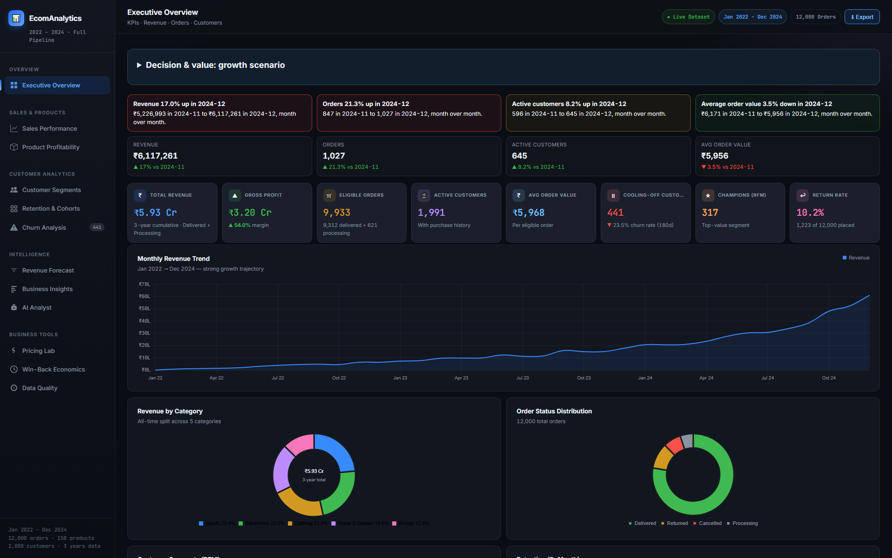
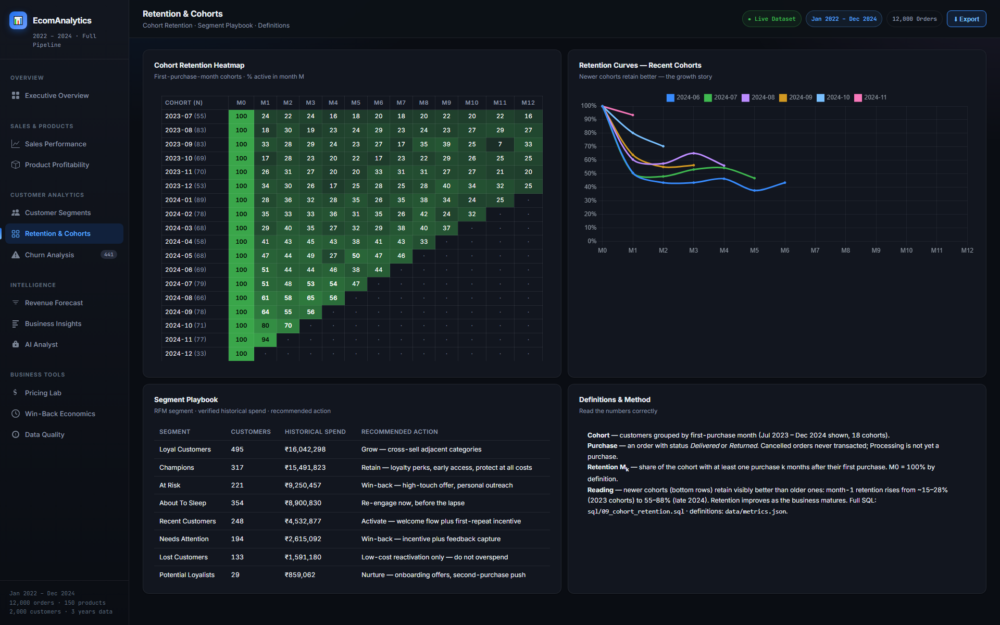
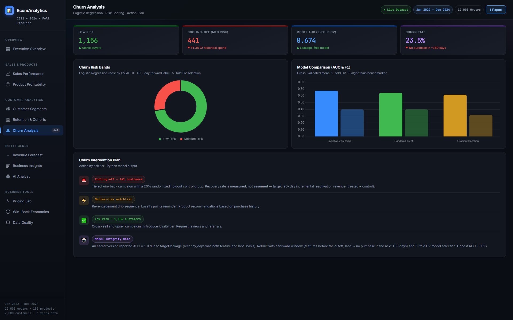
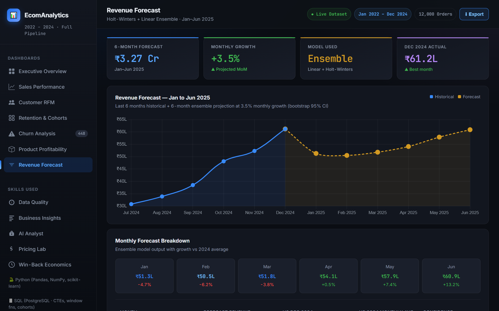
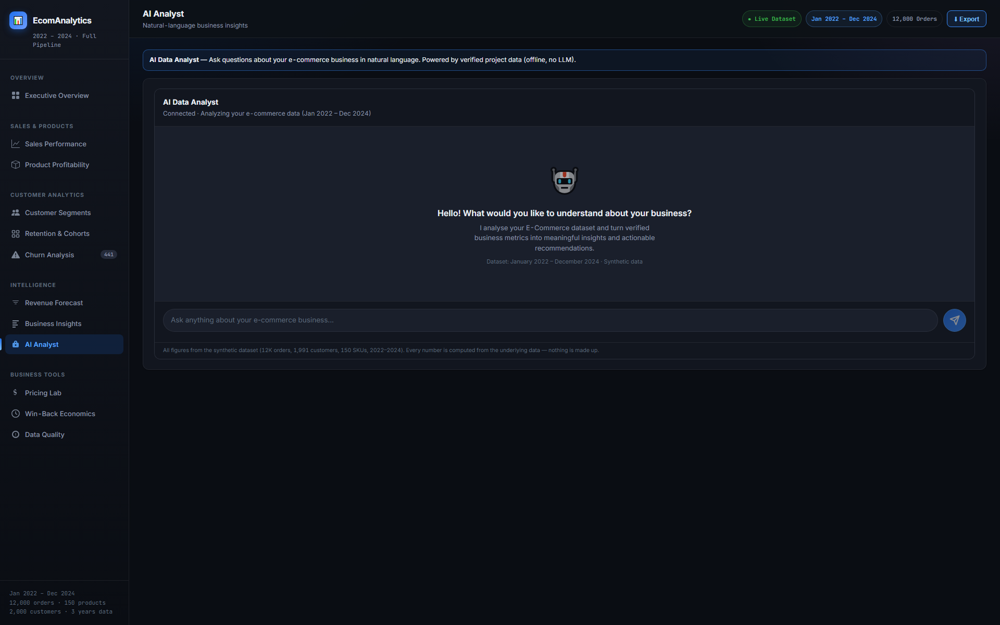
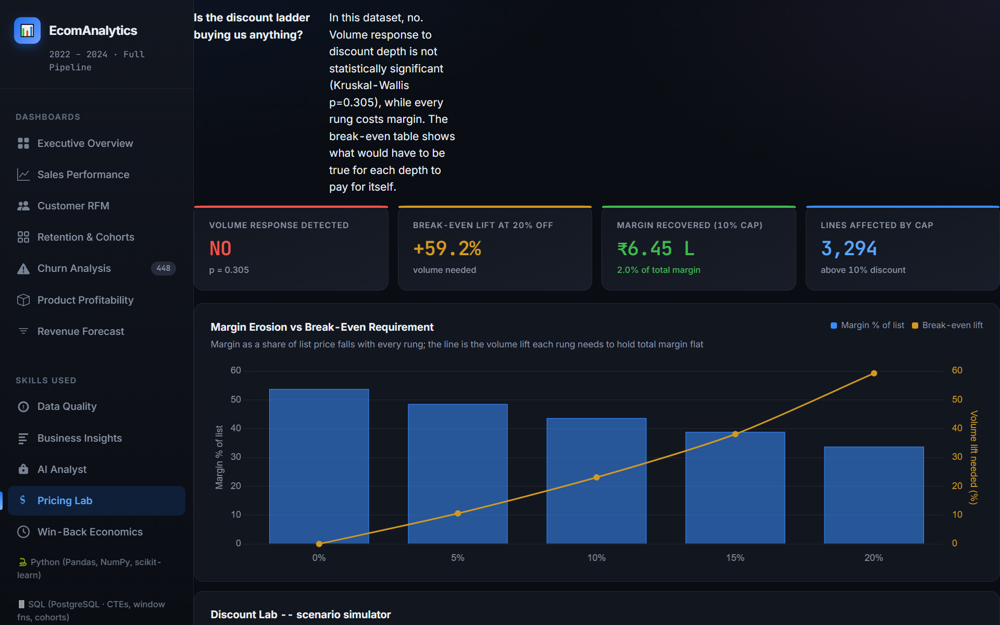
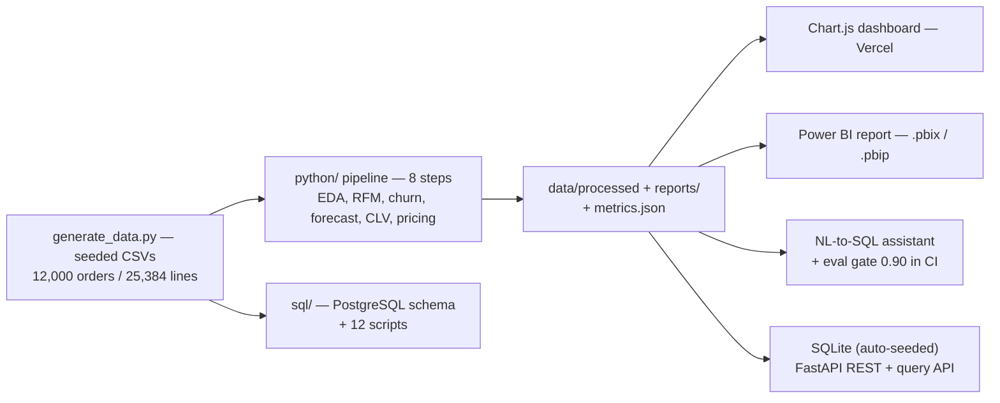

# E-Commerce Sales & Customer Analytics

<p align="center">
  <a href="https://github.com/rishi-1603/E_commerce-Sales-and-Data-Analytics">GitHub Repository</a> ·
  <a href="https://ecomanalytics-dashboard.vercel.app/">Live Web Dashboard (Vercel)</a> ·
  <a href="powerbi/pbix/EcomAnalytics.pbip">Power BI Project (PBIP)</a> ·
  <a href="powerbi/pbix/EcomAnalytics.pbix">Power BI Report (.pbix)</a>
</p>

<p align="center">
  
  
  
  
  
  <a href="https://github.com/rishi-1603/E_commerce-Sales-and-Data-Analytics/actions/workflows/ci.yml"></a>
</p>

<p align="center">
  <a href="https://ecomanalytics-dashboard.vercel.app/">
    
  </a>
  <br>
  <em>Live web dashboard preview (click to open) — Power BI Desktop editing screens are intentionally not used as the README hero image.</em>
</p>

```bash
git clone https://github.com/rishi-1603/E_commerce-Sales-and-Data-Analytics.git
cd E_commerce-Sales-and-Data-Analytics
python -m venv .venv && .venv\Scripts\activate      # Windows; use source .venv/bin/activate elsewhere
pip install -r requirements.txt
python data/raw/generate_data.py && python run_pipeline.py && python -m pytest tests/ -q
```

## Project overview

A complete data-analytics project on a **synthetic, seeded INR dataset**: 12,000 orders, 25,384 order lines, 2,000 customer records and 150 products over Jan 2022 – Dec 2024. It covers the full analyst workflow — data generation and validation, SQL analysis, statistical testing, customer segmentation, churn modelling, forecasting, pricing economics, a 4-page Power BI report, a 12-page Chart.js dashboard on Vercel, and a grounded natural-language-to-SQL assistant.

The project answers four business questions end to end:

1. **Where does revenue come from?** — category, region, segment, payment method, month.
2. **Who are the customers?** — RFM + K-Means segmentation, CLV, churn risk.
3. **Do customers stick?** — first-purchase cohorts, month-over-month retention.
4. **What should we do next?** — win-back targeting, discount economics, revenue forecast.

Every headline figure is defined once in [`data/metrics.json`](data/metrics.json) (a central definition/evidence registry kept in sync with the evaluation scripts' report outputs — not an output of `run_pipeline.py` itself) and pinned by 284 tests. Where a method underperforms — the forecast loses to a naive baseline, the win-back "profit" is revenue before cost of goods, the 95% interval covers 9.5% of actuals — the README says so and points at the evidence.

The dataset is synthetic and seeded (fully reproducible via `data/raw/generate_data.py`). Methods and engineering are the substance; the numbers are illustrative and should not be read as real business performance.

## Dataset

A seeded, fully reproducible star schema covering **2022-01-31 → 2024-12-30**, INR-denominated:

| Table | Rows | Grain |
|---|---|---|
| `orders.csv` | 12,000 | one row per placed order — status Delivered / Processing / Cancelled / Returned |
| `order_items.csv` | 25,384 | one row per order line — quantity, unit price, discount, cost |
| `customers.csv` | 2,000 | one row per customer record — B2B / B2C / Enterprise |
| `products.csv` | 150 | one row per SKU across 5 categories |

Cleaning produces `data/processed/master_orders.csv`: **21,066 lines across 9,933 revenue-eligible orders** (Delivered + Processing only). The other 4,318 lines belong to the 2,067 orders that ended Cancelled or Returned — they are counted in the funnel, never in revenue.

Two population reconciliations that the rest of this document depends on:

- **2,000 customer records → 1,991 active customers.** 1,999 records appear in orders; 8 of those have only Cancelled/Returned orders (4 Returned, 2 Cancelled, 2 both) and 1 never ordered. 1,991 is the revenue-eligible population used by RFM, CLV and the churn feature table.
- **12,000 placed orders → 9,933 eligible orders.** 621 Processing orders are booked but not fulfilled. Including them is a deliberate basis choice stated on every revenue figure; on a Delivered-only basis revenue is ₹55,492,687.66, not ₹59,283,619.32.

Regenerate byte-identically with `python data/raw/generate_data.py`. Validation logic lives in `sql/02_data_cleaning.sql` and `python/eda/01_eda_preprocessing.py`; the data-quality results are in [`docs/DATA_QUALITY_SCORECARD.md`](docs/DATA_QUALITY_SCORECARD.md).

## Key performance indicators

| KPI | Value |
|---|---|
| Revenue (Delivered + Processing, 9,933 orders) | ₹59,283,619.32 |
| Cost of goods sold | ₹27,286,277.68 |
| Gross profit | ₹31,997,341.64 |
| Gross margin | 53.97% |
| Orders placed | 12,000 |
| Delivered | 9,312 (77.6%) |
| Processing | 621 (5.2%) |
| Cancelled | 844 (7.03%) |
| Returned | 1,223 (10.19%) |
| Active customers | 1,991 |
| Average order value (per eligible order) | ₹5,968.35 |

Order statuses are **mutually exclusive**: 9,312 + 621 + 844 + 1,223 = 12,000. `Returned` is its own exit at 10.19% of placed orders — it is never subtracted from `Delivered`. On orders that reached a terminal state (Delivered + Returned = 10,535) the return rate is 11.61%; both numbers are correct with their denominators named.

**Why 53.97% and 53.79% both appear.** The headline margin is value-weighted: gross profit ÷ revenue = 53.97%. The discount curve uses the unweighted mean of line-level margin rates, which is 53.79% at 0% discount. Zero-discount orders aggregate to 56.67% margin and discounted orders to 51.96% — the gap is product and order mix, not an arithmetic error. This is reconciled in [`reports/methodology.md`](reports/methodology.md) §7.

Full definitions — numerator, denominator, population and pinned values — live in [`data/metrics.json`](data/metrics.json); exact-to-the-penny values are enforced by the test suite. The independent recomputation is in [`docs/AUDIT_2026-11-18.md`](docs/AUDIT_2026-11-18.md).

## Dashboard showcase

### Power BI report (4 pages)

The report ships in two forms:

- **`powerbi/pbix/EcomAnalytics.pbix`** — compiled report with the data model embedded. Open it directly in Power BI Desktop; visuals render immediately with data, no refresh required.
- **`powerbi/pbix/EcomAnalytics.pbip`** — the editable Power BI project (PBIR format + TMDL semantic model), for development and version control.

The screenshots below are captured from the compiled report and reconcile with the KPI table above to the penny.

| Executive Overview | Sales Performance |
|---|---|
|  |  |
| **Customer Insights** | **Order Operations** |
|  |  |

- **Executive Overview** — Revenue ₹59.28M, Gross Profit ₹32.00M, Margin 53.97%, Delivered 9,312, AOV ₹5.97K, Customers 1,991; the segment table totals exactly ₹59,283,619.32 and 1,991.
- **Sales Performance** — the category reconciliation table sums to ₹59,283,619.32 revenue, ₹27,286,277.68 COGS, ₹31,997,341.64 gross profit, 53.97% margin.
- **Customer Insights** — segment economics: B2B 403 + B2C 1,379 + Enterprise 209 = 1,991 customers; blended AOV ₹5,968.35.
- **Order Operations** — statuses are mutually exclusive: 12,000 placed = 9,312 delivered + 621 processing + 844 cancelled + 1,223 returned; 10.19% of placed orders had Returned status.

### Web dashboard (Vercel)

A static Chart.js dashboard deployed at [ecomanalytics-dashboard.vercel.app](https://ecomanalytics-dashboard.vercel.app/). It is a separate artifact from the Power BI report.

This README shows sixteen dashboard views in total — the four Power BI pages above and all twelve pages of the web dashboard (the lead image at the top is the web Executive Overview; the remaining eleven are below) — each shown exactly once. The web screenshots were captured from the live Vercel deployment in November 2026 and reconcile with the KPI table above.

| Sales Performance | Customer RFM Segmentation |
|---|---|
|  |  |
| **Retention & Cohorts** | **Churn Analysis** |
|  |  |
| **Product Profitability** | **Revenue Forecast** |
|  |  |
| **Data Quality** | **Business Insights** |
|  |  |
| **AI Analyst** | **Pricing Lab** |
|  |  |
| **Win-Back Economics** | |
|  | |

> Web screenshots were captured from the live Vercel deployment on 2026-11-23
> and show the current state — out-of-fold churn scoring, the Q&A headers on
> Pricing Lab and Win-Back, and the current KPI values. They reconcile with
> the KPI table above.

- **Sales Performance** — 9,312 delivered (77.6% of placed); Sports is the top category (₹1.39 Cr), West the top region (₹1.23 Cr).
- **Customer RFM Segmentation** — K-Means segments over Recency · Frequency · Monetary, summing to exactly 1,991 customers.
- **Retention & Cohorts** — first-purchase cohort heatmap. Month-1 retention *appears* to rise to 55–88% for late-2024 cohorts, but that is a **right-censoring artifact**: 12 of 36 cohorts have fewer than 12 months observed (Nov 2024 has 1, Dec 2024 has 0). It is not evidence of improving retention.
- **Churn Analysis** — leakage-free Logistic Regression selected by 5-fold CV (CV ROC-AUC 0.674, holdout ROC-AUC 0.662 / PR-AUC 0.332). The 441 customers are the **Medium Risk band** — a targeting pool, not confirmed churners.
- **Product Profitability** — a BCG-style **proxy** over all 150 products, split on median units sold and median margin: 36 Stars, 38 Cash Cows, 39 Question Marks, 37 Dogs. There is no market-share data, so it is not the classic BCG matrix.
- **Revenue Forecast** — a 6-month projection (Jan–Jun 2025, ₹3.27 Cr) from the ensemble fitted through Dec 2024; its accuracy rests on a rolling-origin backtest (10 origins × 3 horizons over 2024 out-of-sample months), not on the projection itself: MASE 0.68 loses to the drift baseline (0.468) and the 95% bootstrap band covered 9.5% of actuals. A `holt_linear` challenger scores 0.3752 but is not deployed.
- **Data Quality** — automated reconciliation checks all pass: 0 duplicate keys, 0 nulls, 0 orphan rows, 0 non-positive line totals, 0 invalid statuses, discounts within 0–20%. The 9 customers with no revenue-eligible order are disclosed, not silently dropped.
- **Business Insights** — every insight follows Observation → Evidence → Impact → Recommendation → Measurement, with no invented figures.
- **AI Analyst** — offline, client-side analyst answering 100+ question patterns across 18 topic areas (including revenue, categories, products, customers, churn, forecasting, pricing, win-back, cohorts, risks and recommendations) with professional structured responses; no SQL shown to users, no LLM required. All figures from the verified dataset.
- **Pricing Lab** — no statistically detectable volume lift across discount depths (Kruskal-Wallis H = 4.834, df = 4, p = 0.305); the 20% rung would need +59.24% volume to hold margin flat. Capping discounts at 10% recovers ₹644,518 of margin (2.0%). The page leads with that plain-language verdict, then the KPI cards, a Discount Lab simulator and the full break-even table.
- **Win-Back Economics** — 441 Medium Risk customers (₹1.30 Cr historical spend); ₹523 **expected net revenue before COGS** per contact at 15% recovery, i.e. ≈₹167 of contribution at the 54.0% gross margin. Revenue break-even churn probability 12.54%; margin-adjusted ≈23.2%.

## Tech stack

| Layer | Technology |
|---|---|
| Data generation | Python (pandas, numpy) — seeded, reproducible |
| Analytics pipeline | Python 3.11 (scikit-learn, statsmodels, scipy, matplotlib, seaborn) |
| Database | PostgreSQL 14+ (schema + 12 SQL scripts in `sql/`); SQLite for the API runtime |
| API & AI analyst | FastAPI + SQLAlchemy (async) with sqlglot-guarded queries; grounded NL-to-SQL assistant (`app/`, `evals/`) |
| Excel reporting | openpyxl-authored workbooks with live formulas — `Ecommerce_BI_Companion.xlsx` + `EcomAnalytics_Business_Reporting.xlsx` (`powerbi/`) |
| BI modelling | Power BI semantic model via TMDL; DAX measure dictionary + Power Query M transformations (`powerbi/`) |
| Reporting | Power BI Desktop (PBIR format) |
| Web dashboard | Chart.js, static HTML on Vercel |
| Containerization | Docker (`Dockerfile`, `docker-compose.yml`) |
| Migrations | Alembic (SQLAlchemy) |
| Testing | pytest (284 tests) + flake8 + NL-to-SQL eval gate |
| CI | GitHub Actions |

## Skills demonstrated

Every technology above is applied, not listed — each deliverable exercises it:

| Deliverable | Skills it proves |
|---|---|
| Python pipeline (8 steps) | pandas / NumPy wrangling, RFM + K-Means segmentation, cohort retention, churn classification, CLV, time-series forecasting, product profitability |
| Statistical analysis | SciPy hypothesis testing (t-test, ANOVA, χ², Kruskal-Wallis), effect sizes, discount elasticity break-even math |
| 12 SQL scripts | PostgreSQL star schema, CTEs, window functions, cohort and funnel queries, returns analysis, discount-margin analysis |
| Power BI (.pbix / .pbip) | TMDL semantic modeling, DAX measures at order-line grain, Power Query M transforms, 4-page report design |
| Excel workbooks | openpyxl automation, live-formula executive models, monthly reconciliation tables |
| FastAPI + NL-to-SQL | REST API design, SQLAlchemy async, sqlglot injection guarding, LLM grounding with verified fact sheet + refusals |
| Chart.js dashboard | static-site deployment (Vercel), responsive layout, WCAG-conscious markup |
| 284 pytest tests | regression discipline — every displayed KPI pinned to the computed layer |
| CI pipeline | GitHub Actions gates: pytest + flake8 + eval accuracy ≥ 0.90 |
| Docker | containerized app deployment (`Dockerfile`, `docker-compose.yml`) |

## Repository structure

```
.
├── data/                  # raw + processed CSVs, metrics.json (semantic layer), data dictionary
├── python/                # analytics pipeline (eda, segmentation, churn, forecast, pricing, clv)
├── sql/                   # database schema, cleaning + 10 analysis scripts
├── app/                   # FastAPI service — REST endpoints + grounded NL-to-SQL query API
├── evals/                 # NL-to-SQL benchmark + eval runner (CI accuracy gate)
├── powerbi/pbix/          # PBIP project (semantic model + report) and compiled .pbix
├── dashboard/             # Chart.js dashboard (source)
├── dashboard.html / index.html   # deployed web dashboard copies (kept byte-identical)
├── scripts/               # decision_layer, calibration, backtest, challenger, dashboard injection
├── tests/                 # pytest suite (284 tests)
├── reports/               # generated JSON + markdown reports
├── docs/                  # screenshots, methodology, model card, data-quality and audit documents
└── run_pipeline.py        # pipeline entry point
```

## Architecture



Two database engines, one schema, never mixed in one query path. **PostgreSQL** is the analytics target for the SQL showcase (window functions, CTEs, `FILTER`, date math) and is not executed by CI — those scripts are verified by review and by the fact that every figure they produce is recomputed in Python and pinned by tests. **SQLite** is the zero-config runtime for the FastAPI demo, auto-created and seeded on first start. Full contracts: [`docs/ARCHITECTURE_AND_INTERFACES.md`](docs/ARCHITECTURE_AND_INTERFACES.md).

The pipeline runs eight steps in order: seeded data generation → EDA/preprocessing → RFM segmentation → churn analysis → revenue forecasting → product profitability/BCG → statistical analysis → CLV. Deeper evaluation scripts (churn calibration, forecast backtest, forecast challenger, pricing, win-back, AI eval) and the decision layer run separately — the evaluation ones before tests in CI — so pinned metrics are always regenerated from code, never hand-edited.

## How to run locally

### Prerequisites

- Python 3.11
- (Optional) Power BI Desktop for the `.pbip`
- (Optional) PostgreSQL 14+ for the `sql/` scripts

### Installation

```bash
git clone https://github.com/rishi-1603/E_commerce-Sales-and-Data-Analytics.git
cd E_commerce-Sales-and-Data-Analytics
python -m venv .venv
# Windows
.venv\Scripts\activate
# macOS / Linux
source .venv/bin/activate
pip install -r requirements.txt
```

### Running the pipeline

```bash
python data/raw/generate_data.py   # regenerate synthetic data (byte-identical)
python run_pipeline.py              # 8-step analytics pipeline
python -m pytest tests/ -q          # 284 tests
python evals/run_eval.py --min-accuracy 0.90   # AI eval gate
```

### Dashboard and API

```bash
python scripts/inject_pricing_dashboard.py      # re-sync the 4 byte-identical dashboard copies
uvicorn app.main:app --reload                    # FastAPI on http://127.0.0.1:8000/docs
```

### Power BI report

Open `powerbi/pbix/EcomAnalytics.pbip` in Power BI Desktop, then click **Refresh now** to load the CSVs. The `.pbix` needs no refresh.

## Testing and validation

```bash
python -m pytest tests/ -q
```

All 284 tests pass, and the same suite runs in CI. It pins KPI values (revenue, COGS, profit, margin, order counts), the discount break-even ladder, the funnel, cohort retention, churn calibration, forecast backtest, the win-back economics, and the dashboard's embedded `DATA` block against the computed layer. Two contracts worth calling out:

- **Dashboard copies stay byte-identical.** `dashboard.html`, `index.html`, `dashboard/dashboard.html` and `dashboard/index.html` are checked by SHA256; the inject script rewrites pricing sections and syncs all four.
- **Claims are recomputed, not trusted.** The repo's `verify-claims` procedure recomputes every displayed figure from `data/raw/*.csv` and compares against `data/metrics.json`. The latest independent pass is [`docs/AUDIT_2026-11-18.md`](docs/AUDIT_2026-11-18.md) — all headline KPIs match to the cent.

```bash
python -m flake8 python/ run_pipeline.py app/ --max-line-length=120   # CI lint gate
```

## Grounded AI analyst

A natural-language-to-SQL assistant (`scripts/nl_to_sql.py`) answers data questions in two modes: a **deterministic grounded path** used by CI (no external LLM key needed) and an optional LLM path that is scored separately. Alongside it, the FastAPI app (`app/`) exposes a query endpoint whose SQL executes behind a sqlglot AST guard — SELECT-only, whitelisted tables, enforced `LIMIT 100` — so mutating or off-scope statements are refused.

Evaluation is independent by design: ground truth is computed with pandas straight from `data/processed/master_orders.csv`, never from the system under test, and refusals are scored on their own — an unanswerable question answered with a number is penalised harder than an admission. Benchmark v1.1 (37 questions): **37/37 = 100.0% execution accuracy, 100% refusal correctness, 0 fabricated numbers** (`mode=fallback`). That figure is scoped to this benchmark, not a general accuracy claim. CI fails below the 0.90 gate. Full report: [`reports/ai_eval_report.md`](reports/ai_eval_report.md).

## Key business findings

**Executive summary.** Revenue is ₹5.93 Cr at 53.97% gross margin, but the analysis is more useful for what it refuses to overclaim: discounts do not pay for themselves at any rung, the forecast is worse than a drift baseline, and the win-back case survives a margin adjustment only because the audience's churn probability is high. Those three findings are the ones a stakeholder should act on.

- **Revenue concentration**: the top 10% of customers hold ~42% of projected lifetime value — observed concentration in this synthetic population, not a causal claim.
- **Discounts do not pay for themselves**: no statistically detectable overall quantity response (Kruskal-Wallis H = 4.834, df = 4, p = 0.305; OLS slope −0.0614, p = 0.704). Every rung needs more volume than observed to hold margin flat. Sports is the one significant category effect and it is *negative* (−6.96% at 20 pp, p = 0.003).
- **Returns deserve investigation, not alarm**: 1,223 returned orders (10.19% of the 12,000 placed; 11.61% of terminal orders), worth ₹7,234,984.25 in line value. Returned is an exit status, not a subtraction from Delivered.
- **The cohort "improvement" is an artifact**: month-1 retention looks higher for late-2024 cohorts only because their observation windows are shorter. 12 of 36 cohorts have under 12 months observed. No retention trend is claimed.
- **The forecast is honest about its limits**: shipped ensemble MASE 0.68 loses to the drift baseline (0.468); the 95% bootstrap band covers 9.5% of actuals; a `holt_linear` challenger at 0.3752 is published but not deployed.
- **The churn model is a targeting tool**: Logistic Regression, 5-fold CV ROC-AUC 0.674 and held-out ROC-AUC 0.662 / PR-AUC 0.332 (n = 1,597; label prevalence 23.54%). Published scores are out-of-fold on training customers and holdout predictions on the test slice — no in-sample refit probabilities. At the profit-maximizing threshold t\* = 0.12 the held-out test slice yields ₹72,849 expected net revenue vs ₹69,537 for contact-all with 93 fewer contacts (227 vs 320 contacts). A separate 5-origin rolling backtest gives CV AUC 0.56–0.67; the 80/20 split is **not** described as temporal.
- **The win-back case survives a margin check**: 441 Medium Risk customers, ₹1.30 Cr historical spend, ₹523 expected net revenue per contact at 15% recovery. Before COGS that is a 12.54% break-even churn probability; at 54.0% margin it is ≈₹167 per contact and ≈23.2% break-even — still below the band's mean churn probability of 38.75%. No campaign has been run. The page leads with the campaign answer, then the sensitivity grid and the budget worklist.

### Discount break-even ladder

| Discount depth | Margin % of list | Break-even volume lift |
|---|---|---|
| 0% | 53.79% | 0.00% |
| 5% | 48.63% | 10.61% |
| 10% | 43.69% | 23.12% |
| 15% | 38.94% | 38.14% |
| 20% | 33.78% | 59.24% |

### Win-back assumptions (all illustrative)

| Assumption | Value | Status |
|---|---|---|
| Contact cost | ₹250 per customer | Illustrative |
| Recovery rate | 15% | Not measured; most sensitive input |
| Retained value | ₹13,292 (mean 180-day spend) | Observed on retained customers, **revenue before COGS** |
| Audience | 441 Medium Risk customers | Model band, not confirmed churners |
| Break-even churn probability | 12.54% revenue / ≈23.2% margin-adjusted | Derived |
| Campaign run? | No | Design only — [`docs/experiment_design_winback.md`](docs/experiment_design_winback.md) |

## Limitations & future improvements

- The dataset is **synthetic**; all figures are illustrative and methods are the deliverable.
- The discount, returns and churn analyses are **observational** — association, not causation. Discounts are assigned by the business, not randomly.
- The win-back experiment is a **design only** — no campaign has been run and no uplift has been measured.
- The revenue forecast **underperforms a drift baseline** in its rolling-origin backtest and its interval under-covers badly (9.5% vs 95% nominal).
- The churn model (CV ROC-AUC 0.674, holdout 0.662) is a targeting tool, not a per-customer oracle. Calibration is not uniformly helpful: isotonic fitted on 1,277 out-of-fold predictions improves holdout Brier 0.1726 → 0.1715, while the script's 256-row calibration slice overfits (Brier 0.172 → 0.1815). Both results are published.
- The BCG view is a **proxy** (median units vs median margin), not the classic market-share/market-growth matrix.
- The FastAPI app and SQL scripts are not deployed publicly and the SQL is not executed in CI — they are a runnable showcase, not a production service.

Next steps: run the win-back experiment as designed and measure incremental lift; replace the shipped forecast with the `holt_linear` challenger or a drift baseline; extend the published 5-origin churn backtest and retrain monthly; add a real data source and re-run the pipeline end to end.

## Author

Rishi — [GitHub](https://github.com/rishi-1603) · [Repository](https://github.com/rishi-1603/E_commerce-Sales-and-Data-Analytics)

Supporting documents: [metric dictionary](data/DATA_DICTIONARY.md) · [data-quality scorecard](docs/DATA_QUALITY_SCORECARD.md) · [statistical methodology](reports/methodology.md) · [model card](docs/MODEL_CARD.md) · [model & AI evaluation](docs/MODEL_AND_AI_EVALUATION.md) · [SQL showcase](sql/README.md) · [architecture](docs/ARCHITECTURE_AND_INTERFACES.md) · [audit](docs/AUDIT_2026-11-18.md)

 
 
 
