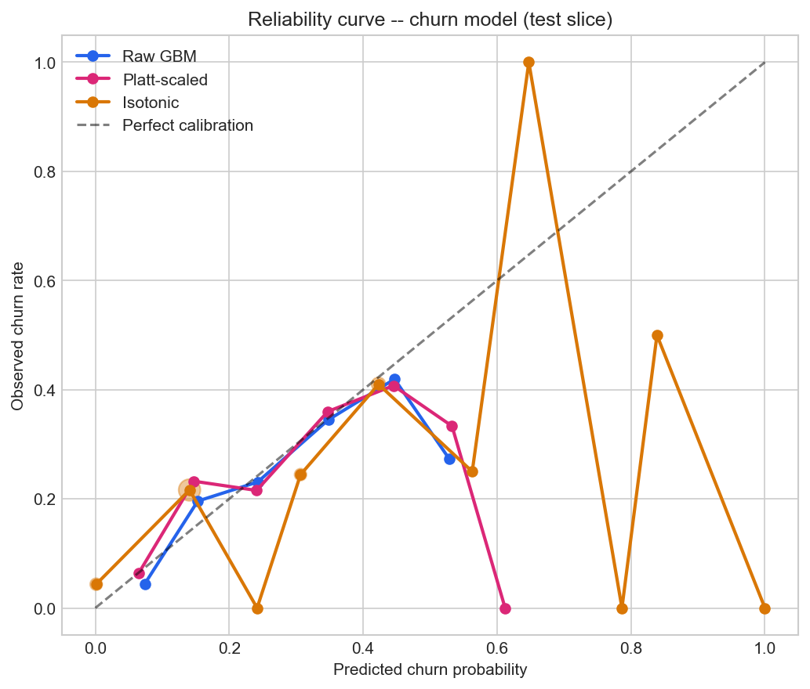
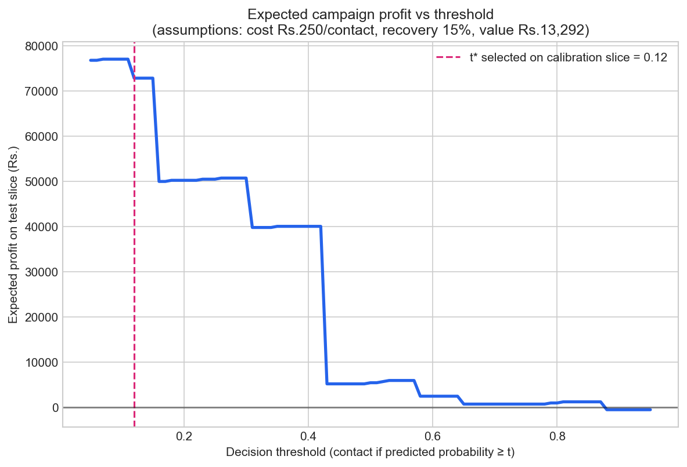

# Churn Model -- Calibration, Decision Thresholds & Error Analysis
### What the AUC of 0.66 does NOT tell you -- and what to do instead

> Generated by `scripts/churn_calibration.py` · protocol: **fit 64% / calibration 16% / test 20%, stratified, random_state=42; dataset from scripts/churn_data.py (purchases = Delivered or Returned; revenue = master_orders.csv)**
> Dataset: `scripts/churn_data.py` -- activity/label uses the project purchase definition (Delivered or Returned); revenue features use `master_orders.csv` (Delivered + Processing).
> n = 1,597 eligible customers (fit 1,021 / calibration 256 / test 320) · churn prevalence 23.5%

---

## 1. Are the probabilities honest? (calibration)

Ranking quality: **ROC-AUC 0.657** · **PR-AUC 0.3307** (prevalence = 0.235; PR-AUC is the number that matters on this imbalanced problem -- random ranking scores ≈ prevalence).

Reference: always predicting the base rate gives Brier **0.2344**; the model must beat this to add probability-level value.

| Variant | Brier ↓ | ECE (10-bin) ↓ | Calib. intercept (=0 ideal) | Calib. slope (=1 ideal) |
|---|---|---|---|---|
| raw | 0.172 | 0.032 | -0.258 | 0.7875 |
| platt | 0.1734 | 0.0482 | -0.308 | 0.6761 |
| isotonic | 0.1815 | 0.0774 | -0.9003 | 0.1299 |

**Reading the table:** a slope < 1 means predictions are too extreme (over-confident); a slope > 1 means too timid. Calibration only helps when it improves the held-out Brier/ECE — on this split the raw model is already close to calibrated, and the calibrators fit on the 256-row calibration slice overfit. `03_churn_analysis.py` therefore fits isotonic on 1,277 out-of-fold rows instead of a small slice.

### Reliability table (isotonic, test slice)

| Predicted bin | n | Mean predicted | Observed churn rate |
|---|---|---|---|
| [0.0,0.1] | 46 | 0.0013 | 0.0435 |
| [0.1,0.2] | 148 | 0.1407 | 0.2162 |
| [0.2,0.3] | 2 | 0.2416 | 0.0 |
| [0.3,0.4] | 45 | 0.3065 | 0.2444 |
| [0.4,0.5] | 61 | 0.423 | 0.4098 |
| [0.5,0.6] | 12 | 0.5629 | 0.25 |
| [0.6,0.7] | 1 | 0.6474 | 1.0 |
| [0.7,0.8] | 1 | 0.7865 | 0.0 |
| [0.8,0.9] | 2 | 0.8388 | 0.5 |
| [0.9,1.0] | 2 | 1.0 | 0.0 |

---

## 2. Who should the campaign contact? (cost-based thresholds)

> ⚠️ **Assumptions box -- read before quoting any profit number.**
> - Contact cost **C = Rs.250** per customer (incentive + ops) -- *illustrative*
> - Recovery rate **r = 15%** of contacted churners are retained -- *illustrative*
> - Retained-customer value **V = Rs.13,292** -- the mean observed 180-day spend of customers who did *not* churn (horizon-aligned, measured from the data; lifetime historical spend averages Rs.20,588 for context)
> - Profit figures are *expected values under these assumptions*, not measured outcomes. No campaign has been run.

Under these assumptions the Bayes-optimal threshold is **t = C/(r·V) = 0.125**: contact anyone whose churn probability exceeds it. Selecting the threshold empirically on the calibration slice gives **t\* = 0.12**.

### Policy comparison (untouched test slice)

| Policy | Contacts | Churners captured | Capture rate | Precision | Expected profit |
|---|---|---|---|---|---|
| contact_none | 0 | 0 | 0.0% | 0.0% | Rs.0 |
| contact_all | 320 | 75 | 100.0% | 23.4% | Rs.69,537 |
| current_band_medium_plus (p>=0.33) | 80 | 30 | 40.0% | 37.5% | Rs.39,815 |
| current_band_high_only (p>=0.66) | 5 | 1 | 1.3% | 20.0% | Rs.744 |
| data_driven_t_star (p>=0.12) | 227 | 65 | 86.7% | 28.6% | Rs.72,849 |
| oracle (upper bound) | 75 | 75 | 100.0% | 100.0% | Rs.149,537 |

### Sensitivity (±30% on cost and recovery rate)

| Recovery r | Cost C | Bayes t | Contacts | Churners captured | Expected profit |
|---|---|---|---|---|---|
| 10.5% | Rs.175 | 0.125 | 227 | 65 | Rs.50,994 |
| 10.5% | Rs.250 | 0.179 | 126 | 41 | Rs.25,723 |
| 10.5% | Rs.325 | 0.233 | 125 | 41 | Rs.16,598 |
| 15.0% | Rs.175 | 0.088 | 274 | 73 | Rs.97,600 |
| 15.0% | Rs.250 | 0.125 | 227 | 65 | Rs.72,849 |
| 15.0% | Rs.325 | 0.163 | 127 | 41 | Rs.40,472 |
| 19.5% | Rs.175 | 0.068 | 274 | 73 | Rs.141,264 |
| 19.5% | Rs.250 | 0.097 | 274 | 73 | Rs.120,714 |
| 19.5% | Rs.325 | 0.125 | 227 | 65 | Rs.94,704 |

### Operating points (isotonic probabilities)

| Threshold | Precision | Recall | F1 | Contacts |
|---|---|---|---|---|
| 0.25 | 0.328 | 0.547 | 0.410 | 125 |
| 0.33 | 0.375 | 0.400 | 0.387 | 80 |
| 0.5 | 0.278 | 0.067 | 0.107 | 18 |
| 0.66 | 0.200 | 0.013 | 0.025 | 5 |
| 0.75 | 0.200 | 0.013 | 0.025 | 5 |

### Capacity curve -- if investigators can only reach k% of customers

| Top-k% by risk | Contacts | Churners captured | Capture rate | Precision | Lift vs random |
|---|---|---|---|---|---|
| 5% | 16 | 5 | 6.7% | 31.2% | 1.33× |
| 10% | 32 | 9 | 12.0% | 28.1% | 1.19× |
| 20% | 64 | 22 | 29.3% | 34.4% | 1.46× |
| 30% | 96 | 36 | 48.0% | 37.5% | 1.59× |
| 50% | 160 | 47 | 62.7% | 29.4% | 1.25× |

---

## 3. Who does the model miss? (error analysis at t\*)

### By Recency band

| Band | n | Churn rate | False positives | False negatives |
|---|---|---|---|---|
| recent | 108 | 18.5% | 32 | 4 |
| mid | 105 | 22.9% | 59 | 4 |
| lapsed | 107 | 29.0% | 71 | 2 |

### By Purchase frequency band

| Band | n | Churn rate | False positives | False negatives |
|---|---|---|---|---|
| low_freq | 107 | 15.9% | 43 | 4 |
| mid_freq | 106 | 25.5% | 56 | 3 |
| high_freq | 107 | 29.0% | 63 | 3 |

### By Tenure band

| Band | n | Churn rate | False positives | False negatives |
|---|---|---|---|---|
| new | 108 | 13.0% | 14 | 10 |
| established | 106 | 23.6% | 78 | 0 |
| veteran | 106 | 34.0% | 70 | 0 |

**How to read this:** false negatives (missed churners) concentrated in one band mean the model under-serves that segment -- the fix is either segment-specific features or a segment-specific threshold. False positives concentrated in low-frequency bands usually mean small-sample noise is being read as risk (the same failure mode documented in the Zomato project).

---

## 4. Limitations

1. Synthetic data -- methods transfer, numbers don't.
2. All monetary values are illustrative expected values under stated assumptions; no campaign has been run and no revenue has been recovered.
3. Threshold selection used the calibration slice; test-set results are honest, but a real deployment should re-select t\* on recent actuals after every retraining.
4. Recovery rate r is unidentifiable from observational data -- it is the single most important assumption and the sensitivity table shows how much the answer moves with it.
5. V uses observed spend of retained customers over the 180-day window; forward-looking CLV would raise V and push t\* downward (higher value justifies contacting more customers).

## 5. What this changes in the project

- `churn_features.csv` publishes cross-validated, isotonic-calibrated probabilities (`03_churn_analysis.py`); the raw score is kept as `churn_probability_raw`.
- The 0.33/0.66 risk bands are *communication* bands on the calibrated scale, not the action rule. Under the stated cost model the action threshold is t\* = 0.12, which contacts more customers than the Medium band alone.
- The 256-row calibration slice is too small for a stable isotonic/Platt fit; the pipeline calibrates on out-of-fold predictions from the full training split instead.
- `docs/MODEL_CARD.md` now carries these sections.

---

*Numbers pinned by `tests/test_churn_calibration.py` against `reports/churn_calibration_metrics.json`.*