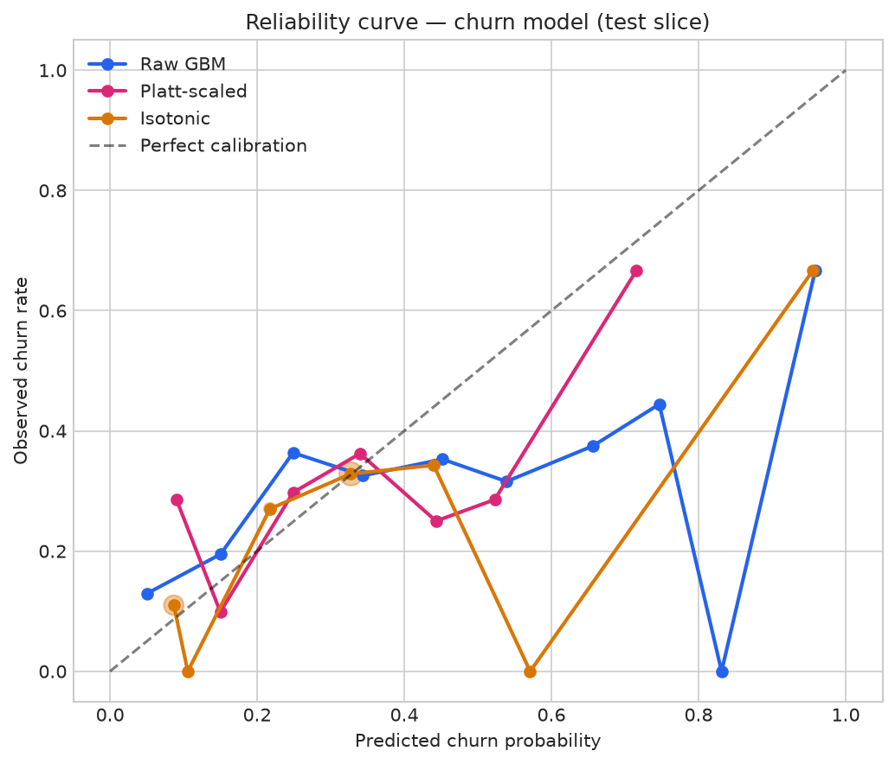
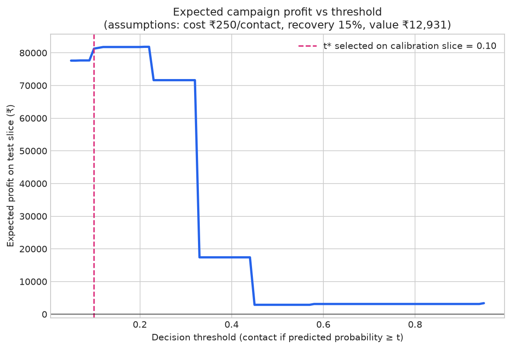

# Churn Model — Calibration, Decision Thresholds & Error Analysis
### What the AUC of 0.65 does NOT tell you — and what to do instead

> Generated by `scripts/churn_calibration.py` · protocol: **fit 64% / calibration 16% / test 20%, stratified, random_state=42**
> n = 1,586 eligible customers (fit 1,014 / calibration 254 / test 318) · churn prevalence 25.4%

---

## 1. Are the probabilities honest? (calibration)

Ranking quality: **ROC-AUC 0.6489** · **PR-AUC 0.3664** (prevalence = 0.254; PR-AUC is the number that matters on this imbalanced problem — random ranking scores ≈ prevalence).

Reference: always predicting the base rate gives Brier **0.2547**; the model must beat this to add probability-level value.

| Variant | Brier ↓ | ECE (10-bin) ↓ | Calib. intercept (=0 ideal) | Calib. slope (=1 ideal) |
|---|---|---|---|---|
| raw | 0.1952 | 0.0966 | -0.5709 | 0.3913 |
| platt | 0.1817 | 0.0602 | -0.1487 | 0.8761 |
| isotonic | 0.1811 | 0.0299 | -0.3505 | 0.6524 |

**Reading the table:** a slope < 1 means predictions are too extreme (over-confident); a slope > 1 means too timid. Isotonic/Platt scaling fix probability quality without changing the ranking (AUC is invariant to monotone transforms).

### Reliability table (isotonic, test slice)

| Predicted bin | n | Mean predicted | Observed churn rate |
|---|---|---|---|
| [0.0,0.1] | 100 | 0.0867 | 0.11 |
| [0.1,0.2] | 2 | 0.1057 | 0.0 |
| [0.2,0.3] | 37 | 0.2174 | 0.2703 |
| [0.3,0.4] | 140 | 0.3274 | 0.3286 |
| [0.4,0.5] | 35 | 0.44 | 0.3429 |
| [0.5,0.6] | 1 | 0.5711 | 0.0 |
| [0.6,0.7] | 0 | — | — |
| [0.7,0.8] | 0 | — | — |
| [0.8,0.9] | 0 | — | — |
| [0.9,1.0] | 3 | 0.9554 | 0.6667 |

---

## 2. Who should the campaign contact? (cost-based thresholds)

> ⚠️ **Assumptions box — read before quoting any profit number.**
> - Contact cost **C = ₹250** per customer (incentive + ops) — *illustrative*
> - Recovery rate **r = 15%** of contacted churners are retained — *illustrative*
> - Retained-customer value **V = ₹12,931** — the mean observed 180-day spend of customers who did *not* churn (horizon-aligned, measured from the data; lifetime historical spend averages ₹20,777 for context)
> - Profit figures are *expected values under these assumptions*, not measured outcomes. No campaign has been run.

Under these assumptions the Bayes-optimal threshold is **t = C/(r·V) = 0.129**: contact anyone whose churn probability exceeds it. Selecting the threshold empirically on the calibration slice gives **t\* = 0.10**.

### Policy comparison (untouched test slice)

| Policy | Contacts | Churners captured | Capture rate | Precision | Expected profit |
|---|---|---|---|---|---|
| contact_none | 0 | 0 | 0.0% | 0.0% | ₹0 |
| contact_all | 318 | 81 | 100.0% | 25.5% | ₹77,615 |
| current_band_medium_plus (p>=0.33) | 39 | 14 | 17.3% | 35.9% | ₹17,406 |
| current_band_high_only (p>=0.66) | 3 | 2 | 2.5% | 66.7% | ₹3,129 |
| data_driven_t_star (p>=0.1) | 218 | 70 | 86.4% | 32.1% | ₹81,279 |
| oracle (upper bound) | 81 | 81 | 100.0% | 100.0% | ₹157,115 |

### Sensitivity (±30% on cost and recovery rate)

| Recovery r | Cost C | Bayes t | Contacts | Churners captured | Expected profit |
|---|---|---|---|---|---|
| 10.5% | ₹175 | 0.129 | 216 | 70 | ₹57,245 |
| 10.5% | ₹250 | 0.184 | 216 | 70 | ₹41,045 |
| 10.5% | ₹325 | 0.239 | 179 | 60 | ₹23,292 |
| 15.0% | ₹175 | 0.090 | 279 | 76 | ₹98,592 |
| 15.0% | ₹250 | 0.129 | 216 | 70 | ₹81,779 |
| 15.0% | ₹325 | 0.168 | 216 | 70 | ₹65,579 |
| 19.5% | ₹175 | 0.069 | 279 | 76 | ₹142,817 |
| 19.5% | ₹250 | 0.099 | 218 | 70 | ₹122,012 |
| 19.5% | ₹325 | 0.129 | 216 | 70 | ₹106,312 |

### Operating points (isotonic probabilities)

| Threshold | Precision | Recall | F1 | Contacts |
|---|---|---|---|---|
| 0.25 | 0.335 | 0.741 | 0.462 | 179 |
| 0.33 | 0.359 | 0.173 | 0.233 | 39 |
| 0.5 | 0.500 | 0.025 | 0.047 | 4 |
| 0.66 | 0.667 | 0.025 | 0.048 | 3 |
| 0.75 | 0.667 | 0.025 | 0.048 | 3 |

### Capacity curve — if investigators can only reach k% of customers

| Top-k% by risk | Contacts | Churners captured | Capture rate | Precision | Lift vs random |
|---|---|---|---|---|---|
| 5% | 15 | 3 | 3.7% | 20.0% | 0.79× |
| 10% | 31 | 10 | 12.3% | 32.3% | 1.27× |
| 20% | 63 | 21 | 25.9% | 33.3% | 1.32× |
| 30% | 95 | 31 | 38.3% | 32.6% | 1.29× |
| 50% | 159 | 53 | 65.4% | 33.3% | 1.32× |

---

## 3. Who does the model miss? (error analysis at t\*)

### By Recency band

| Band | n | Churn rate | False positives | False negatives |
|---|---|---|---|---|
| recent | 106 | 26.4% | 36 | 9 |
| mid | 106 | 27.4% | 50 | 2 |
| lapsed | 106 | 22.6% | 62 | 0 |

### By Purchase frequency band

| Band | n | Churn rate | False positives | False negatives |
|---|---|---|---|---|
| low_freq | 106 | 16.0% | 33 | 7 |
| mid_freq | 106 | 26.4% | 59 | 1 |
| high_freq | 106 | 34.0% | 56 | 3 |

### By Tenure band

| Band | n | Churn rate | False positives | False negatives |
|---|---|---|---|---|
| new | 106 | 15.1% | 20 | 10 |
| established | 107 | 21.5% | 71 | 1 |
| veteran | 105 | 40.0% | 57 | 0 |

**How to read this:** false negatives (missed churners) concentrated in one band mean the model under-serves that segment — the fix is either segment-specific features or a segment-specific threshold. False positives concentrated in low-frequency bands usually mean small-sample noise is being read as risk (the same failure mode documented in the Zomato project).

---

## 4. Limitations

1. Synthetic data — methods transfer, numbers don't.
2. All monetary values are illustrative expected values under stated assumptions; no campaign has been run and no revenue has been recovered.
3. Threshold selection used the calibration slice; test-set results are honest, but a real deployment should re-select t\* on recent actuals after every retraining.
4. Recovery rate r is unidentifiable from observational data — it is the single most important assumption and the sensitivity table shows how much the answer moves with it.
5. V uses observed spend of retained customers over the 180-day window; forward-looking CLV would raise V and push t\* downward (higher value justifies contacting more customers).

## 5. What this changes in the project

- The risk bands in `03_churn_analysis.py` (0.33/0.66) were arbitrary quantile cuts. They are defensible as *communication* bands; the **action** threshold is t\* = 0.10 under the stated cost model.
- Probabilities should be consumed through the isotonic calibrator, not the raw GBM output.
- `docs/MODEL_CARD.md` now carries these sections.

---

*Numbers pinned by `tests/test_churn_calibration.py` against `reports/churn_calibration_metrics.json`.*