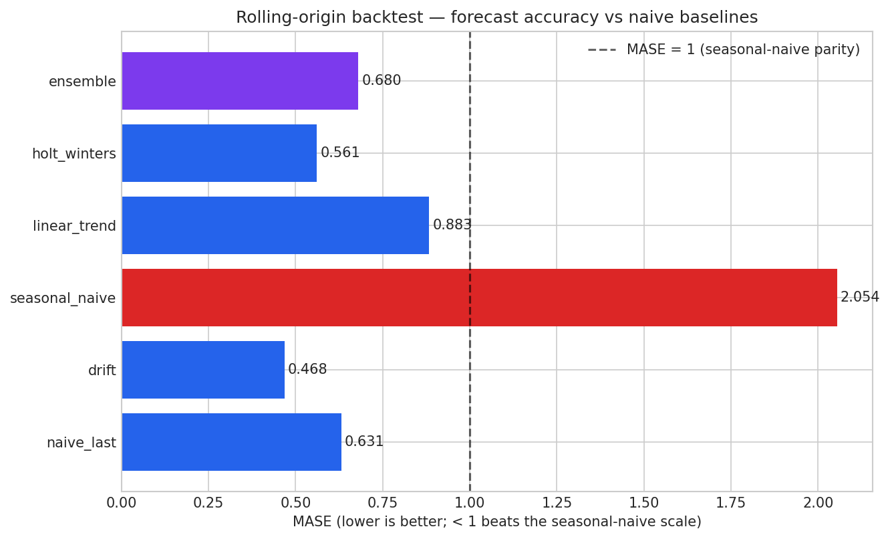

# Revenue Forecast — Rolling-Origin Backtest
### Does the ensemble earn its complexity? Out-of-sample evidence vs naive baselines

> Generated by `scripts/forecast_backtest.py` · **10 origins** × 3 horizons (h = 1, 2, 3) · monthly series (36 months)
> MASE scale: in-sample seasonal-naive MAE (|y_t - y_t-12| mean), averaged over origins = ₹1,023,756

---

## 1. The leaderboard (all origins pooled)

| Model | MAE | RMSE | **MASE** | h=1 MASE | h=2 MASE | h=3 MASE |
|---|---|---|---|---|---|---|
| naive_last | 646,197 | 855,741 | **0.631** | 0.296 | 0.601 | 0.996 |
| drift | 479,264 | 680,756 | **0.468** | 0.242 | 0.444 | 0.719 |
| seasonal_naive | 2,102,719 | 2,266,975 | **2.054** | 1.802 | 2.032 | 2.328 |
| linear_trend | 903,757 | 1,121,605 | **0.883** | 0.631 | 0.854 | 1.164 |
| holt_winters | 574,687 | 774,783 | **0.561** | 0.420 | 0.506 | 0.758 |
| ensemble ⭐ | 696,202 | 923,138 | **0.680** | 0.433 | 0.657 | 0.950 |

## 2. The verdict

- Ensemble overall MASE: **0.680**
- Best naive baseline: **drift** (MASE 0.468)
- Ensemble beats best baseline: **NO**

> **The ensemble beats seasonal-naive in-sample scale (MASE<1) but NOT the strongest baseline (drift). Prefer the simpler baseline for operational forecasts; keep the ensemble as a cross-check.**

## 3. Is the confidence band honest? (empirical coverage)

The shipped bootstrap-95% CI method (residuals from a 3-point holdout) was mirrored at every origin. Empirical coverage of the nominal 95% band: **9.5%** (21 forecast points).

| Horizon | Empirical coverage |
|---|---|
| h1 | 28.6% |
| h2 | 0.0% |
| h3 | 0.0% |

> ⚠️ **Finding:** the band under-covers. Three residuals are a very small sample to estimate forecast variance — treat the shipped 95% CI as *indicative width*, not a calibrated interval. A real deployment should estimate error variance from the full rolling-origin residual history (this backtest: 10 origins × 3 horizons).

## 4. Per-origin detail

| Origin (last train month) | MASE scale | naive_last | drift | seasonal_naive | linear_trend | holt_winters | ensemble (MAE) |
|---|---|---|---|---|---|---|---|
| 2023-12 | 873,757 | 288,144 | 132,558 | 1,255,776 | 334,670 | 211,785 | 236,103 |
| 2024-01 | 910,143 | 102,680 | 83,638 | 1,262,198 | 283,518 | 121,578 | 130,632 |
| 2024-02 | 937,167 | 336,026 | 200,690 | 1,421,401 | 395,456 | 291,452 | 281,631 |
| 2024-03 | 950,161 | 607,186 | 445,679 | 1,645,375 | 598,067 | 436,939 | 517,503 |
| 2024-04 | 976,153 | 607,494 | 434,088 | 1,840,087 | 712,306 | 548,913 | 630,610 |
| 2024-05 | 1,022,620 | 406,912 | 210,338 | 1,996,801 | 753,283 | 309,974 | 436,215 |
| 2024-06 | 1,066,030 | 403,359 | 238,328 | 2,145,339 | 839,065 | 569,073 | 704,069 |
| 2024-07 | 1,112,563 | 942,642 | 738,235 | 2,596,838 | 1,249,179 | 591,384 | 915,969 |
| 2024-08 | 1,168,747 | 1,236,096 | 1,017,811 | 3,087,162 | 1,671,117 | 946,540 | 1,149,221 |
| 2024-09 | 1,220,217 | 1,531,434 | 1,291,274 | 3,776,213 | 2,200,914 | 1,719,234 | 1,960,074 |

## 5. Limitations

1. Synthetic revenue series (36 months) — the *method* transfers, the numbers don't.
2. Only 3-step horizons are evaluated; the shipped 6-month forecast extrapolates beyond anything this backtest can verify.
3. MASE scaling uses seasonal-naive in-sample error (period 12); comparisons assume monthly seasonality is real in the series.
4. Origins overlap (expanding window) — per-origin MAEs are not independent; the leaderboard is a summary, not a significance test.
5. The Holt-Winters configuration is fixed (damped trend, multiplicative seasonality); no per-origin hyperparameter search was performed.

---

*Numbers pinned by `tests/test_forecast_backtest.py` against `reports/forecast_backtest_metrics.json`.*